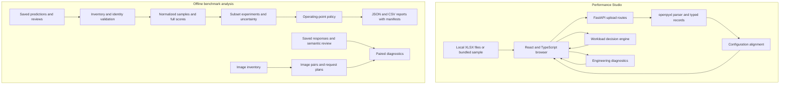

# Performance & Quality Lab

**Live application:** [Performance Studio](https://ai-model-quality-challenge-rho.vercel.app/)

Performance & Quality Lab supports two parts of model selection: serving performance and answer quality.
Performance Studio compares workbook projections against workload requirements.
The benchmark package tests how smaller question sets affect recorded quality scores and decisions.

The web app and benchmark package run independently.
They share a repository, but they do not share an API, database, or runtime process.
The live application hosts Performance Studio. Benchmark analysis runs locally.

## Start here

| Goal                                     | Document                                                 |
| ---------------------------------------- | -------------------------------------------------------- |
| Install and use the project              | [Usage guide](USAGE.md)                                  |
| Understand the system                    | [Architecture](#architecture)                            |
| Integrate the performance API            | [Backend reference](backend/README.md)                   |
| Change the browser interface             | [Frontend reference](frontend/README.md)                 |
| Understand benchmark methods and reports | [Benchmark reference](task2/README.md)                   |
| Understand performance assumptions       | [Performance design](docs/task1-analysis.md)             |
| Inspect model and workload estimates     | [Projection analysis](docs/task1-models-and-profiles.md) |
| Configure hosting                        | [Deployment guide](docs/vercel-deployment.md)            |

## Capabilities and scope

| Component                    | Implemented behavior                                                                                        | Interpretation                                                                               |
| ---------------------------- | ----------------------------------------------------------------------------------------------------------- | -------------------------------------------------------------------------------------------- |
| Performance Studio           | Upload, align, and compare Excel projections. Evaluate workload requirements. Inspect trends and anomalies. | Results describe supplied projections. Production measurements require a separate load test. |
| Reference analysis           | Validate saved predictions and reviews. Reproduce six full benchmark scores.                                | No model endpoint is called.                                                                 |
| Subset experiments           | Compare stratified subsets, weighted scores, model order, and threshold decisions.                          | Results apply to the supplied historical panel.                                              |
| Operating-point analysis     | Select the smallest tested candidate that passes the configured policy.                                     | The recorded policy selects full retention: 315 coding tasks and 100 long-context questions. |
| Image-pair prototype         | Create image variants, export request plans, and analyze saved responses.                                   | The demonstration uses synthetic images and scripted answers.                                |
| Native EvalScope integration | Preserve source pins, reference panels, export tools, and audit tools.                                      | Adapter implementations live in a separate private repository. They are not included here.   |

No smaller tested subset passed every recorded policy gate.
The project does not establish live inference savings or a validated multimodal subset.

## Quick start

Use Python 3.12, uv, and Node.js 24.x.
Run these installation commands from the repository root:

```powershell
cd backend
uv sync --locked
cd ../frontend
npm ci
```

In terminal 1, start the API from the repository root:

```powershell
cd backend
uv run uvicorn perf_api.main:app --reload --host 127.0.0.1 --port 8000
```

In terminal 2, start the browser server from the repository root:

```powershell
cd frontend
npm run dev -- --port 5173 --strictPort
```

Open [Performance Studio](http://127.0.0.1:5173).
Select **Load sample workbook**.
The sample follows the same upload and validation path as a user file.

The [usage guide](USAGE.md) contains a worked comparison, API commands, benchmark commands, and fault recovery procedures.
Dependency installation requires network access or a prepared package cache.
Local app operation and saved-data analysis require no model API key.

## Architecture

### System boundaries



The browser sends HTTP requests to the Python API.
The API processes workbooks in memory and returns JSON.
The application code has no database, account system, or persistent upload store.
Browser state holds the active session; a page reload clears that session.

Benchmark commands read local files and write local reports.
They do not use the web API.
The image prototype exports future request bodies, but it does not send those requests.

### Repository structure

```text
backend/
  src/perf_api/          HTTP routes, schemas, parser, and analysis functions
  tests/                 Parser, API, decision, comparison, and resilience tests
frontend/
  src/                   Upload flow, comparison view, decisions, and diagnostics
  public/sample/         Bundled workbook
  tests/                 Browser journeys, accessibility checks, and fixtures
task2/
  src/benchmark_reference/  Saved-data validation, subset studies, and image tools
  data/                  Historical reference panels for external integration
  tools/                 Audits, panel exports, source verification, and image demo
  tests/                 Synthetic fixtures and method checks
  evalscope-*.json        Version pins and external integration metadata
Evals/                   Saved benchmark artifacts managed through Git LFS
docs/
  data/                  Recorded summaries, manifests, and source audit results
  scripts/               Projection summary generation
perf_data.zip            Supplied performance workbooks
vercel.json              Frontend and API service routing
USAGE.md                 Installation and operating procedures
```

### Performance data flow

1. The browser submits one or more `.xlsx` files as multipart form data.
2. The parser reads the `Summary` worksheet and checks its required headers.
3. The parser fills merged scenario cells and converts each row into a `PerformanceRecord`.
4. The comparison function groups rows by matching configuration keys.
5. The browser displays matched rows, missing models, and upload diagnostics.
6. The decision engine evaluates complete rows against the selected workload requirements.
7. The engineering engine computes metrics, controlled trends, and anomaly evidence.

Model identity comes from the filename.
For example, `Model A profile 1.xlsx` gives model `Model A` and profile `1`.
Unrecognized filenames use the filename stem and profile `unknown`.
The parser does not contain a fixed model list.

The alignment key contains five fields:

```text
(profile_id, input_length, output_length, round(cache_percentage, 4), batch_size)
```

Rows with different keys remain separate.
A missing model appears as a coverage gap.
Identical duplicate sweeps collapse into one sweep.
Conflicting sweeps and sweeps with duplicate configuration keys are excluded with diagnostics.
Valid files can still load when another file fails.

### Performance modules

| Module                                  | Responsibility                                                        |
| --------------------------------------- | --------------------------------------------------------------------- |
| `frontend/src/App.tsx`                  | Coordinates uploads, active selections, and analysis state.           |
| `workbooks.ts`, `comparisons.ts`        | Define upload and comparison contracts and browser helpers.           |
| `ComparisonView.tsx`                    | Displays aligned configurations and coverage.                         |
| `DecisionView.tsx`, `decisions.ts`      | Collect requirements and display decision evidence.                   |
| `EngineeringView.tsx`, `engineering.ts` | Display diagnostic metrics, trends, and source references.            |
| `backend/src/perf_api/routes/`          | Accepts HTTP input and calls analysis functions.                      |
| `parser.py`, `schemas.py`               | Convert workbook bytes into typed projection records.                 |
| `comparison.py`                         | Aligns configurations and identifies duplicate or conflicting inputs. |
| `decision.py`                           | Evaluates workload constraints and selects a representative row.      |
| `engineering.py`                        | Computes diagnostics without changing or deleting projection rows.    |

HTTP routes handle transport and input validation.
Analysis functions operate on typed records without HTTP dependencies.
This separation permits direct tests of decision and comparison rules.

### Workload decisions

A scenario contains input tokens, output tokens, and cache fraction.
The API can omit scenario fields; omitted fields do not filter rows.
The browser requires a specific scenario for a multi-model comparison.
Requirements can specify capacity, generation speed, time to first token, context, and hardware cost.

| API status          | Display label | Rule                                                                              |
| ------------------- | ------------- | --------------------------------------------------------------------------------- |
| `go`                | GO            | At least one complete matching row meets every applicable check.                  |
| `no_go`             | NO GO         | Every matching row has at least one known failure.                                |
| `insufficient_data` | NEEDS DATA    | No requirements exist, no row matches, or a possible pass requires missing facts. |

Equality meets a limit.
The engine checks all applicable metrics on the same row.
It never combines one row's capacity with another row's latency.
The response includes every evaluated configuration and the representative row's evidence.
Workbook order resolves selection ties.

For example, a row can meet a capacity requirement and fail a latency requirement.
That row cannot support GO.
Another matching batch can support GO only if that complete row passes all checks.

Context support requires an explicit supported context window.
The required window is the larger of the requested minimum and the row's input-plus-output length.
A projected input length alone does not establish context support.

Hardware cost uses the following estimate:

```text
USD per million projected throughput tokens =
  box-hour price * 1,000,000 / (throughput_per_box * 3,600)
```

For example, a price of USD 4 per box-hour and capacity of 2,000 tokens/second gives approximately USD 0.556 per million tokens.
The estimate assumes sustained projected capacity.
It excludes idle time, software charges, and other operating costs.

### Engineering diagnostics

The engineering engine preserves reported metrics and adds derived ratios.
It compares batch sizes only when other scenario dimensions match.
It compares cache fractions only when the model, profile, lengths, and batch size match.

Anomaly rules identify inconsistent throughput components, negative values, and selected scaling drops.
Flags contain the rule and source record indices.
A flag requests investigation; it does not prove that a projection is incorrect.
Source indices identify normalized records, not original Excel row numbers.

### Benchmark data flow

The reference loader expects 28 prediction/review pairs across 56 files.
The coding and long-context panels contain three models each.
Each coding model has 315 tasks; each long-context model has 100 questions.
The MMMU reference contains 660 rows across 22 subjects for one model.
The full loader therefore validates 1,905 joined sample results.

The loader rejects missing partners, unexpected files, malformed grades, duplicate identities, and model mismatches.
Missing grades do not become zero scores.
Errors include source paths and line numbers.

| Module group                               | Responsibility                                                      |
| ------------------------------------------ | ------------------------------------------------------------------- |
| `inputs.py`, `analysis.py`, `models.py`    | Validate files, join predictions to reviews, and represent samples. |
| `pruning.py`, `long_context.py`            | Select stratified coding and long-context subsets.                  |
| `experiments.py`, `transfer.py`            | Evaluate held-out models and independently held-out model pairs.    |
| `uncertainty.py`, `study_metrics.py`       | Compute intervals, ordering evidence, and threshold outcomes.       |
| `judge_noise.py`                           | Report sensitivity to hypothetical changed judgments.               |
| `operating_points.py`                      | Apply score, ordering, uncertainty, and decision gates.             |
| Reporting modules                          | Write scores, selections, summaries, and manifests.                 |
| `mmmu_images.py`                           | Build normalized original images and controlled variants.           |
| `mmmu_requests.py`, `mmmu_measurements.py` | Export request plans and analyze saved paired attempts.             |

### Subset methods and uncertainty

Coding candidates group tasks by historical difficulty or reference response patterns.
Long-context candidates group questions by length and document count, or by length and historical difficulty.
The target model's grades do not enter its subset selector.
Pair comparisons exclude both compared models from selection inputs.

Each occupied stratum receives samples.
Population weights correct for different sampling rates between strata.
A raw subset average can give the wrong full-population estimate.
The [benchmark reference](task2/README.md#weighted-score-example) gives a numerical example.

The default experiments test retained fractions of 10%, 20%, 30%, 50%, and 100%, with twenty seeds.
A fraction describes the amount retained.
For example, 10% of 315 tasks retains 32 tasks after rounding upward.
Budgets that cannot cover every occupied stratum fail.

Intervals describe sampling uncertainty within the fixed recorded pool.
They do not measure future model behavior, generation variation, or judge randomness.
A threshold result is inconclusive when the interval crosses the threshold.
Full retention removes subset sampling error; it does not remove errors in recorded grades.

Reports use deterministic ordering and content hashes.
Each file is replaced atomically, and the manifest is written last.
Publication across several files is not a transaction.
A reader must check manifest hashes after an interrupted run.

## Recorded results

These scores describe saved artifacts, not current model endpoints.

| Benchmark        | Model        | Successful samples | Mean score |
| ---------------- | ------------ | ------------------ | ---------- |
| LiveCodeBench v5 | gpt-oss-120b | 241 / 315          | 0.765079   |
| LiveCodeBench v5 | kimi-k2.5    | 198 / 315          | 0.628571   |
| LiveCodeBench v5 | minimax-m2.5 | 195 / 315          | 0.619048   |
| AA-LCR           | gpt-oss-120b | 48 / 100           | 0.480000   |
| AA-LCR           | kimi-k2.5    | 66 / 100           | 0.660000   |
| AA-LCR           | minimax-m2.5 | 64 / 100           | 0.640000   |

The [recorded scores](docs/data/task2-full-scores.json) and [source manifest](docs/data/task2-manifest.json) identify the reference inputs.
The [operating-point results](docs/data/task2-operating-selected.json) retain the full recorded panels under the illustrative policy.
These results do not establish a generally sufficient benchmark size.

## Image-pair prototype

The prototype creates variants through downsampling, blur, JPEG compression, occlusion, contrast changes, color changes, and text-region blur.
It preserves question text and changes one selected image slot per sample.
Content hashes bind image bytes, transformation settings, and pair identities.

Request plans exclude accepted answers.
Reports require saved responses and explicit semantic review states.
They separate correct answers, regressions, format failures, and missing attempts.
Missing-attempt bounds describe incomplete observations; they are not confidence intervals.

The [image harness reference](task2/MMMU_HARNESS.md) defines inputs and scoring.
The [research design](task2/MMMU_PROBE_DESIGN.md) describes the larger proposed study.
The supplied MMMU reference does not represent the full dataset inventory.

## Development and deployment

The [usage guide](USAGE.md#verification) lists tests, static checks, and build commands.
Python tests cover pure functions and HTTP boundaries.
Browser tests cover uploads, customer decisions, engineering evidence, recovery, and accessibility scans.
Synthetic benchmark fixtures provide known expected answers.

Local development uses a Vite proxy for `/api` requests.
The configured Vercel deployment builds separate frontend and backend services under one domain.
`/api/*` and `/health` reach the backend; remaining paths reach the frontend.
The [deployment guide](docs/vercel-deployment.md) describes configuration and verification.

The app has no authentication, durable sessions, or application-level upload size limits.
The Python process reads uploaded workbooks into memory.
Production capacity and resource limits require separate validation.

## Terminology and documentation

| Term              | Meaning                                                                            |
| ----------------- | ---------------------------------------------------------------------------------- |
| Projection        | A supplied performance estimate.                                                   |
| Sweep             | One model/profile workbook with several configurations.                            |
| Configuration     | One scenario and batch size.                                                       |
| Capacity          | Aggregate projected throughput in tokens/second.                                   |
| Generation speed  | Output tokens/second for one user.                                                 |
| TTFT              | Time to first token, measured in milliseconds.                                     |
| Stratum           | A group of questions with shared selection characteristics.                        |
| Retained fraction | The proportion of the original question set selected.                              |
| Operating point   | A candidate method and retained size evaluated against a policy.                   |
| Percentage point  | An absolute difference between percentages; 60% to 63% is three percentage points. |

The documentation uses ASD-STE100 writing principles: short sentences, active voice, consistent technical names, and ordered procedures.
Software identifiers and benchmark names retain their exact spelling.
The [official ASD-STE100 specification](https://www.asd-ste100.org/assets/files/ASD-STE100_ISSUE9.pdf) defines the writing rules and controlled vocabulary.
This documentation does not claim independently audited conformity.
