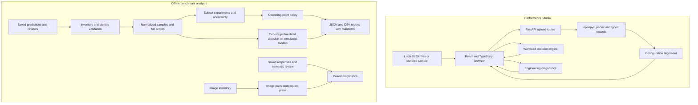
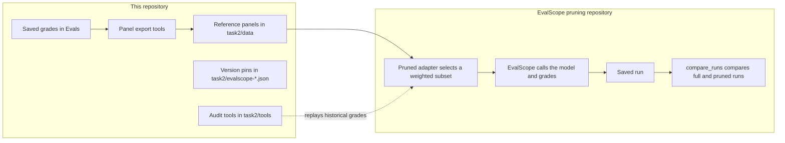
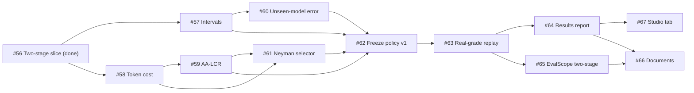

# Performance & Quality Lab

- **Live application:** [Performance Studio](https://ai-model-quality-challenge-rho.vercel.app/)
- **Benchmark runner:** [EvalScope pruning repository](https://github.com/sdv1708/evalscope-pruning)
- **Planned work:** [Known gaps and planned work](#known-gaps-and-planned-work)

Performance & Quality Lab supports two parts of model selection: serving performance and answer quality.
Performance Studio compares workbook projections against workload requirements.
The benchmark package tests how smaller question sets affect recorded quality scores and decisions.
The EvalScope pruning repository runs those smaller question sets against real model endpoints.

The web app and benchmark package run independently.
They share a repository, but they do not share an API, database, or runtime process.
The live application hosts Performance Studio. Benchmark analysis runs locally.

## Current status

This table gives the state of the project on 29 October 2026.

| Area                         | State                  | Result                                                                                                              |
| ---------------------------- | ---------------------- | ------------------------------------------------------------------------------------------------------------------- |
| Performance Studio           | Complete and deployed  | Upload, compare, and evaluate workbook projections in the browser.                                                  |
| Subset studies               | Complete               | No smaller tested subset passed every recorded policy gate. The recorded default keeps 315 of 315 and 100 of 100.   |
| Two-stage threshold decision | First slice complete   | A 63-question probe runs on simulated LiveCodeBench models. The policy is a draft. No replay on real grades exists. |
| EvalScope integration        | Complete for one stage | Two pruned adapters and a run comparison tool work inside EvalScope. The two-stage mode is planned.                 |
| Image-pair prototype         | Prototype              | Synthetic images and scripted answers only. No multimodal subset is validated.                                      |

The [planned work](#known-gaps-and-planned-work) section lists each open gap and the issue that addresses it.

## Start here

| Goal                                     | Document                                                                       |
| ---------------------------------------- | ------------------------------------------------------------------------------ |
| Install and use the project              | [Usage guide](USAGE.md)                                                        |
| Understand the system                    | [Architecture](#architecture)                                                  |
| Integrate the performance API            | [Backend reference](backend/README.md)                                         |
| Change the browser interface             | [Frontend reference](frontend/README.md)                                       |
| Understand benchmark methods and reports | [Benchmark reference](task2/README.md)                                         |
| Run the two-stage threshold decision     | [Usage guide: threshold decision](USAGE.md#run-a-two-stage-threshold-decision) |
| Understand the EvalScope work            | [EvalScope integration](#evalscope-integration)                                |
| Run the native EvalScope adapters        | [EvalScope pruning repository](https://github.com/sdv1708/evalscope-pruning)   |
| Understand performance assumptions       | [Performance design](docs/task1-analysis.md)                                   |
| Inspect model and workload estimates     | [Projection analysis](docs/task1-models-and-profiles.md)                       |
| Configure hosting                        | [Deployment guide](docs/vercel-deployment.md)                                  |
| Follow planned work                      | [Issue tracker](https://github.com/sdv1708/ai-model-benchmark/issues)          |

## Capabilities and scope

| Component                    | Implemented behavior                                                                                        | Interpretation                                                                                                                                |
| ---------------------------- | ----------------------------------------------------------------------------------------------------------- | --------------------------------------------------------------------------------------------------------------------------------------------- |
| Performance Studio           | Upload, align, and compare Excel projections. Evaluate workload requirements. Inspect trends and anomalies. | Results describe supplied projections. Production measurements require a separate load test.                                                  |
| Reference analysis           | Validate saved predictions and reviews. Reproduce six full benchmark scores.                                | No model endpoint is called.                                                                                                                  |
| Subset experiments           | Compare stratified subsets, weighted scores, model order, and threshold decisions.                          | Results apply to the supplied historical panel.                                                                                               |
| Operating-point analysis     | Select the smallest tested candidate that passes the configured policy.                                     | The recorded policy selects full retention: 315 coding tasks and 100 long-context questions.                                                  |
| Two-stage threshold decision | Run a stage-1 probe. Decide GO, NO GO, or ESCALATE. Grade the remaining questions on ESCALATE.              | The draft policy runs on simulated models only. A real-grade replay requires a frozen policy.                                                 |
| Image-pair prototype         | Create image variants, export request plans, and analyze saved responses.                                   | The demonstration uses synthetic images and scripted answers.                                                                                 |
| Native EvalScope integration | Preserve source pins, reference panels, export tools, and audit tools.                                      | Adapter implementations live in the [EvalScope pruning repository](https://github.com/sdv1708/evalscope-pruning). They are not included here. |

No smaller tested subset passed every recorded policy gate.
The project does not establish live inference savings or a validated multimodal subset.
The two-stage threshold decision is the planned route to a smaller probe with a stated error bound.

## Quick start

To use Performance Studio without installation, open the [live application](https://ai-model-quality-challenge-rho.vercel.app/).
To run the project locally, use Python 3.12, uv, and Node.js 24.x.
Run these installation commands from the repository root:

```powershell
cd backend
uv sync --locked
cd ../frontend
npm ci
```

In terminal 1, start the API from the repository root:

```powershell
cd backend
uv run uvicorn perf_api.main:app --reload --host 127.0.0.1 --port 8000
```

In terminal 2, start the browser server from the repository root:

```powershell
cd frontend
npm run dev -- --port 5173 --strictPort
```

Open [the local application](http://127.0.0.1:5173).
Select **Load sample workbook**.
The sample follows the same upload and validation path as a user file.

The [usage guide](USAGE.md) contains a worked comparison, API commands, benchmark commands, and fault recovery procedures.
Dependency installation requires network access or a prepared package cache.
Local app operation and saved-data analysis require no model API key.

## Architecture

### System boundaries



The browser sends HTTP requests to the Python API.
The API processes workbooks in memory and returns JSON.
The application code has no database, account system, or persistent upload store.
Browser state holds the active session; a page reload clears that session.

Benchmark commands read local files and write local reports.
They do not use the web API.
The image prototype exports future request bodies, but it does not send those requests.
The [EvalScope integration](#evalscope-integration) section describes the separate runner for live endpoints.

### Repository structure

```text
backend/
  src/perf_api/          HTTP routes, schemas, parser, and analysis functions
  tests/                 Parser, API, decision, comparison, and resilience tests
frontend/
  src/                   Upload flow, comparison view, decisions, and diagnostics
  public/sample/         Bundled workbook
  tests/                 Browser journeys, accessibility checks, and fixtures
task2/
  src/benchmark_reference/  Saved-data validation, subset studies, threshold decisions, and image tools
  data/                  Historical reference panels for the EvalScope adapters
  policies/              Versioned threshold policies and the frozen-policy lock file
  tools/                 Audits, panel exports, source verification, and image demo
  tests/                 Synthetic fixtures and method checks
  evalscope-*.json       Version pins and EvalScope integration metadata
Evals/                   Saved benchmark artifacts managed through Git LFS
docs/
  data/                  Recorded summaries, manifests, and source audit results
  scripts/               Projection summary generation
perf_data.zip            Supplied performance workbooks
vercel.json              Frontend and API service routing
USAGE.md                 Installation and operating procedures
```

### Performance data flow

1. The browser submits one or more `.xlsx` files as multipart form data.
2. The parser reads the `Summary` worksheet and checks its required headers.
3. The parser fills merged scenario cells and converts each row into a `PerformanceRecord`.
4. The comparison function groups rows by matching configuration keys.
5. The browser displays matched rows, missing models, and upload diagnostics.
6. The decision engine evaluates complete rows against the selected workload requirements.
7. The engineering engine computes metrics, controlled trends, and anomaly evidence.

Model identity comes from the filename.
For example, `Model A profile 1.xlsx` gives model `Model A` and profile `1`.
Unrecognized filenames use the filename stem and profile `unknown`.
The parser does not contain a fixed model list.

The alignment key contains five fields:

```text
(profile_id, input_length, output_length, round(cache_percentage, 4), batch_size)
```

Rows with different keys remain separate.
A missing model appears as a coverage gap.
Identical duplicate sweeps collapse into one sweep.
Conflicting sweeps and sweeps with duplicate configuration keys are excluded with diagnostics.
Valid files can still load when another file fails.

### Performance modules

| Module                                  | Responsibility                                                        |
| --------------------------------------- | --------------------------------------------------------------------- |
| `frontend/src/App.tsx`                  | Coordinates uploads, active selections, and analysis state.           |
| `workbooks.ts`, `comparisons.ts`        | Define upload and comparison contracts and browser helpers.           |
| `ComparisonView.tsx`                    | Displays aligned configurations and coverage.                         |
| `DecisionView.tsx`, `decisions.ts`      | Collect requirements and display decision evidence.                   |
| `EngineeringView.tsx`, `engineering.ts` | Display diagnostic metrics, trends, and source references.            |
| `backend/src/perf_api/routes/`          | Accepts HTTP input and calls analysis functions.                      |
| `parser.py`, `schemas.py`               | Convert workbook bytes into typed projection records.                 |
| `comparison.py`                         | Aligns configurations and identifies duplicate or conflicting inputs. |
| `decision.py`                           | Evaluates workload constraints and selects a representative row.      |
| `engineering.py`                        | Computes diagnostics without changing or deleting projection rows.    |

HTTP routes handle transport and input validation.
Analysis functions operate on typed records without HTTP dependencies.
This separation permits direct tests of decision and comparison rules.

### Workload decisions

A scenario contains input tokens, output tokens, and cache fraction.
The API can omit scenario fields; omitted fields do not filter rows.
The browser requires a specific scenario for a multi-model comparison.
Requirements can specify capacity, generation speed, time to first token, context, and hardware cost.

| API status          | Display label | Rule                                                                              |
| ------------------- | ------------- | --------------------------------------------------------------------------------- |
| `go`                | GO            | At least one complete matching row meets every applicable check.                  |
| `no_go`             | NO GO         | Every matching row has at least one known failure.                                |
| `insufficient_data` | NEEDS DATA    | No requirements exist, no row matches, or a possible pass requires missing facts. |

Equality meets a limit.
The engine checks all applicable metrics on the same row.
It never combines one row's capacity with another row's latency.
The response includes every evaluated configuration and the representative row's evidence.
Workbook order resolves selection ties.

For example, a row can meet a capacity requirement and fail a latency requirement.
That row cannot support GO.
Another matching batch can support GO only if that complete row passes all checks.

Context support requires an explicit supported context window.
The required window is the larger of the requested minimum and the row's input-plus-output length.
A projected input length alone does not establish context support.

Hardware cost uses the following estimate:

```text
USD per million projected throughput tokens =
  box-hour price * 1,000,000 / (throughput_per_box * 3,600)
```

For example, a price of USD 4 per box-hour and capacity of 2,000 tokens/second gives approximately USD 0.556 per million tokens.
The estimate assumes sustained projected capacity.
It excludes idle time, software charges, and other operating costs.

### Engineering diagnostics

The engineering engine preserves reported metrics and adds derived ratios.
It compares batch sizes only when other scenario dimensions match.
It compares cache fractions only when the model, profile, lengths, and batch size match.

Anomaly rules identify inconsistent throughput components, negative values, and selected scaling drops.
Flags contain the rule and source record indices.
A flag requests investigation; it does not prove that a projection is incorrect.
Source indices identify normalized records, not original Excel row numbers.

### Benchmark data flow

The reference loader expects 28 prediction/review pairs across 56 files.
The coding and long-context panels contain three models each.
Each coding model has 315 tasks; each long-context model has 100 questions.
The MMMU reference contains 660 rows across 22 subjects for one model.
The full loader therefore validates 1,905 joined sample results.

The loader rejects missing partners, unexpected files, malformed grades, duplicate identities, and model mismatches.
Missing grades do not become zero scores.
Errors include source paths and line numbers.

| Module group                                                    | Responsibility                                                      |
| --------------------------------------------------------------- | ------------------------------------------------------------------- |
| `inputs.py`, `analysis.py`, `models.py`                         | Validate files, join predictions to reviews, and represent samples. |
| `pruning.py`, `long_context.py`                                 | Select stratified coding and long-context subsets.                  |
| `experiments.py`, `transfer.py`                                 | Evaluate held-out models and independently held-out model pairs.    |
| `uncertainty.py`, `study_metrics.py`                            | Compute intervals, ordering evidence, and threshold outcomes.       |
| `judge_noise.py`                                                | Report sensitivity to hypothetical changed judgments.               |
| `operating_points.py`                                           | Apply score, ordering, uncertainty, and decision gates.             |
| `threshold_policy.py`                                           | Load a policy file, record its hash, and enforce the frozen lock.   |
| `threshold_simulation.py`                                       | Draw simulated models with a known full-set score.                  |
| `two_stage.py`                                                  | Apply the stage-1 interval rule and the census on ESCALATE.         |
| `threshold_study.py`, `threshold_report.py`, `threshold_cli.py` | Write the decision table, summary, HTML report, and manifest.       |
| Reporting modules                                               | Write scores, selections, summaries, and manifests.                 |
| `mmmu_images.py`                                                | Build normalized original images and controlled variants.           |
| `mmmu_requests.py`, `mmmu_measurements.py`                      | Export request plans and analyze saved paired attempts.             |

### Subset methods and uncertainty

Coding candidates group tasks by historical difficulty or reference response patterns.
Long-context candidates group questions by length and document count, or by length and historical difficulty.
The target model's grades do not enter its subset selector.
Pair comparisons exclude both compared models from selection inputs.

Each occupied stratum receives samples.
Population weights correct for different sampling rates between strata.
A raw subset average can give the wrong full-population estimate.
The [benchmark reference](task2/README.md#weighted-score-example) gives a numerical example.

The default experiments test retained fractions of 10%, 20%, 30%, 50%, and 100%, with twenty seeds.
A fraction describes the amount retained.
For example, 10% of 315 tasks retains 32 tasks after rounding upward.
Budgets that cannot cover every occupied stratum fail.

Intervals describe sampling uncertainty within the fixed recorded pool.
They do not measure future model behavior, generation variation, or judge randomness.
A threshold result is inconclusive when the interval crosses the threshold.
Full retention removes subset sampling error; it does not remove errors in recorded grades.

Reports use deterministic ordering and content hashes.
Each file is replaced atomically, and the manifest is written last.
Publication across several files is not a transaction.
A reader must check manifest hashes after an interrupted run.

### Two-stage threshold decision

The subset studies ask whether a small subset reproduces the full score.
The two-stage rule asks a narrower question: is the full-set score of this model at or above the customer threshold `t`?

1. Select a stage-1 probe with the policy stratifier. The selector uses reference grades only.
2. Compute a 95% interval for the full-set score from the probe grades.
3. If the lower bound is at or above `t`, decide GO and stop.
4. If the upper bound is below `t`, decide NO GO and stop.
5. Otherwise, decide ESCALATE. Grade the remaining questions and decide on the full set.

The full set has no sampling error, so ESCALATE always resolves.
A clear pass or a clear fail costs only the probe.
A model near the threshold costs the full benchmark.

A versioned policy file in `task2/policies/` holds the threshold, alpha, probe size, interval method, stratifier, and seeds.
The manifest records the SHA-256 of the exact policy file bytes.
The command refuses a replay on real grades until a policy is marked frozen and its hash is committed in `policies/frozen-policies.json`.
No policy is frozen yet.
The [benchmark reference](task2/README.md#two-stage-threshold-decision) gives the full rule and its limits.

## Recorded results

These scores describe saved artifacts, not current model endpoints.

| Benchmark        | Model        | Successful samples | Mean score |
| ---------------- | ------------ | ------------------ | ---------- |
| LiveCodeBench v5 | gpt-oss-120b | 241 / 315          | 0.765079   |
| LiveCodeBench v5 | kimi-k2.5    | 198 / 315          | 0.628571   |
| LiveCodeBench v5 | minimax-m2.5 | 195 / 315          | 0.619048   |
| AA-LCR           | gpt-oss-120b | 48 / 100           | 0.480000   |
| AA-LCR           | kimi-k2.5    | 66 / 100           | 0.660000   |
| AA-LCR           | minimax-m2.5 | 64 / 100           | 0.640000   |

The [recorded scores](docs/data/task2-full-scores.json) and [source manifest](docs/data/task2-manifest.json) identify the reference inputs.
The [operating-point results](docs/data/task2-operating-selected.json) retain the full recorded panels under the illustrative policy.
These results do not establish a generally sufficient benchmark size.

### Draft two-stage result on simulated models

The draft policy [`lcb-threshold-draft.json`](task2/policies/lcb-threshold-draft.json) uses threshold 0.70 and a 63-question probe (20% of 315).
The run draws 1,000 simulated LiveCodeBench models at each true score, 13,000 models in total.
"Decided at stage 1" is the fraction of models that got GO or NO GO from the probe alone.
A wrong decision differs from the decision on the full-set score.

| True score | Decided at stage 1 | Wrong decisions |
| ---------: | -----------------: | --------------: |
|       0.30 |              1.000 |         0/1,000 |
|       0.35 |              1.000 |         0/1,000 |
|       0.40 |              0.999 |         0/1,000 |
|       0.45 |              0.999 |         0/1,000 |
|       0.50 |              0.969 |         0/1,000 |
|       0.55 |              0.790 |         0/1,000 |
|       0.60 |              0.432 |         0/1,000 |
|       0.65 |              0.091 |         1/1,000 |
|       0.70 |              0.019 |         7/1,000 |
|       0.75 |              0.120 |         0/1,000 |
|       0.80 |              0.544 |         0/1,000 |
|       0.85 |              0.935 |         0/1,000 |
|       0.90 |              0.999 |         0/1,000 |

The probe decides at least 96.9% of models that are 0.20 or more from the threshold.
Near the threshold, most models escalate to the full set.
The highest wrong-decision rate is 7 of 1,000, at true score 0.70.

This result has three limits:

- The models are simulated. The generator uses the same reference difficulty as the stratifier, and this favors stratification.
- The policy is a draft, not a frozen policy.
- The cost is in questions, not tokens.

The published claim therefore stays full retention.
Issues [#57](https://github.com/sdv1708/ai-model-benchmark/issues/57) to [#63](https://github.com/sdv1708/ai-model-benchmark/issues/63) address these limits.
To reproduce the table, run the command in the [usage guide](USAGE.md#run-a-two-stage-threshold-decision).

## EvalScope integration

### What EvalScope is

[EvalScope](https://github.com/modelscope/evalscope) is the open-source LLM evaluation framework of the ModelScope community.
It loads benchmark datasets, sends prompts to a model endpoint, grades the answers, and writes reports.
It includes LiveCodeBench and AA-LCR, the two benchmarks of the subset studies.

### Why this project extends EvalScope

The `task2/` package works only on saved grades. It never calls a model.
To use a pruned benchmark on a new model, the subset selection must run inside a real evaluator.
The [EvalScope pruning repository](https://github.com/sdv1708/evalscope-pruning) adds that selection to EvalScope.
EvalScope continues to build prompts, call the model, run the coding sandbox, run the judge, and write reports.

The repository starts from upstream commit [`66f0945d145ce6c30de40253cd78144003c6f1fe`](https://github.com/modelscope/evalscope/tree/66f0945d145ce6c30de40253cd78144003c6f1fe).
It keeps the upstream Git history, the Apache-2.0 license, and the upstream attribution.
It is a derived repository, not a GitHub fork-network fork.

### What the EvalScope repository adds

| Addition                         | Purpose                                                                                                                    |
| -------------------------------- | -------------------------------------------------------------------------------------------------------------------------- |
| `live_code_bench_pruned` adapter | Selects LiveCodeBench coding questions by historical difficulty strata. It keeps the original grading tests.               |
| `aa_lcr_pruned` adapter          | Selects AA-LCR long-context questions by document length and difficulty strata. It uses an LLM judge.                      |
| Shared reference pruning         | Excludes the target model's grades, allocates the budget across strata, and records a weight for each selected question.   |
| `compare_runs` tool              | Reads a saved full run and a saved pruned run, checks that they match, and reports weighted scores, bounds, and decisions. |
| `pruning_smoke` dataset          | Provides a six-row synthetic dataset that tests the integration only.                                                      |
| Synthetic smoke example          | Runs the real evaluator against a local scripted model and judge, then compares the two saved runs.                        |

The adapters register through the normal EvalScope registry.
A user selects them with `--datasets live_code_bench_pruned` or `--datasets aa_lcr_pruned`.

### How the two repositories connect



1. The export tools build a reference panel from the saved grades. Each question has a SHA-256 fingerprint and the grades of the reference models.
2. The adapter matches every panel fingerprint to the public dataset before inference. A missing or ambiguous match stops the run.
3. The adapter removes the target model's grades from the selection inputs.
4. The selector gives each occupied stratum at least one question. It gives the remaining budget to strata in proportion to their size.
5. Each selected question carries a population weight. Reports give the weighted score.
6. `compare_runs` reads a full run and a pruned run, and reports whether they give the same decision.

The adapters reject `--limit`, because truncation makes the population weights wrong.

### Version pins and audit records

This repository keeps the records that tie each adapter to its exact source.

| File                                                               | Records                                                                                                                                                         |
| ------------------------------------------------------------------ | --------------------------------------------------------------------------------------------------------------------------------------------------------------- |
| [`evalscope-baseline.json`](task2/evalscope-baseline.json)         | Upstream commit and the `pruning_smoke` baseline. Issue [#18](https://github.com/sdv1708/ai-model-benchmark/issues/18).                                         |
| [`evalscope-lcb.json`](task2/evalscope-lcb.json)                   | Coding adapter commit, dataset revision, panel hash, and 1,200 loader parity cases. Issue [#19](https://github.com/sdv1708/ai-model-benchmark/issues/19).       |
| [`evalscope-aa-lcr.json`](task2/evalscope-aa-lcr.json)             | Long-context adapter commit, dataset revision, panel hash, and 100 unique source matches. Issue [#20](https://github.com/sdv1708/ai-model-benchmark/issues/20). |
| [`evalscope-compare-runs.json`](task2/evalscope-compare-runs.json) | Comparison tool commit, schema versions, and test counts. Issue [#21](https://github.com/sdv1708/ai-model-benchmark/issues/21).                                 |

`tools/audit_evalscope_lcb.py` and `tools/audit_evalscope_aa_lcr.py` replay the historical grades through the native loaders.
They require a checkout of the EvalScope pruning repository.
The [benchmark reference](task2/README.md#native-evalscope-boundary) describes these tools.

### Current EvalScope result and limits

The adapter default keeps 315 of 315 coding questions and 100 of 100 long-context questions.
This gives 0% sample saving, and it matches the operating-point result above.
Smaller ratios work, but they are experimental.

The project ran no paid benchmark inference through the adapters.
The verified runs are the synthetic smoke test and the replay of historical grades.
AA-LCR has one recorded judgment per answer, so judge noise is not measured.

### Run the EvalScope smoke test

The smoke test needs Git, uv, Python 3.12, and network access to install packages.
It does not need a GPU, provider credentials, or paid model calls.
The [EvalScope pruning repository](https://github.com/sdv1708/evalscope-pruning) README gives the install commands.
Then run:

```powershell
.venv/Scripts/python.exe examples/aa_lcr_pruned/smoke.py --compare --work-dir outputs/smoke-demo
```

The command starts a scripted model and judge on `127.0.0.1`.
It runs the evaluator on 12 questions, then on a 3-question subset, and compares the two saved runs.
Exit code 0 means that the comparison succeeded.
Use a new `--work-dir` for each run, because the evaluator reuses cached results.

### Next EvalScope step

Issue [#65](https://github.com/sdv1708/ai-model-benchmark/issues/65) adds the two-stage mode to both pruned adapters.
The user runs a stage-1 probe and gets GO, NO GO, or ESCALATE.
On ESCALATE, the user runs the remaining questions.
`compare_runs` then reports the decision, the interval, the stage that decided, and the tokens used.
The mode reads its settings from frozen policy v1, so it starts after the real-grade replay in [#63](https://github.com/sdv1708/ai-model-benchmark/issues/63).

## Image-pair prototype

The prototype creates variants through downsampling, blur, JPEG compression, occlusion, contrast changes, color changes, and text-region blur.
It preserves question text and changes one selected image slot per sample.
Content hashes bind image bytes, transformation settings, and pair identities.

Request plans exclude accepted answers.
Reports require saved responses and explicit semantic review states.
They separate correct answers, regressions, format failures, and missing attempts.
Missing-attempt bounds describe incomplete observations; they are not confidence intervals.

The [image harness reference](task2/MMMU_HARNESS.md) defines inputs and scoring.
The [research design](task2/MMMU_PROBE_DESIGN.md) describes the larger proposed study.
The supplied MMMU reference does not represent the full dataset inventory.

## Known gaps and planned work

The recorded studies leave the gaps below.
Each open issue addresses one gap.
All issues are in the [issue tracker](https://github.com/sdv1708/ai-model-benchmark/issues).

### Gaps with planned work

| Gap                                                                                                                                             | Planned work                                                                                                                                                        |
| ----------------------------------------------------------------------------------------------------------------------------------------------- | ------------------------------------------------------------------------------------------------------------------------------------------------------------------- |
| The recorded per-stratum Bonferroni interval is too wide to decide anything below full retention.                                               | [#57](https://github.com/sdv1708/ai-model-benchmark/issues/57) adds stratified Wilson and stratified bootstrap intervals, and a coverage study on simulated models. |
| Savings are counted in questions, not tokens. One AA-LCR answer uses about 73,000 input tokens. One LiveCodeBench task uses about 1,700 tokens. | [#58](https://github.com/sdv1708/ai-model-benchmark/issues/58) reports the expected token cost of every operating point.                                            |
| The two-stage rule covers LiveCodeBench only.                                                                                                   | [#59](https://github.com/sdv1708/ai-model-benchmark/issues/59) runs AA-LCR through the same pipeline and states the judge-noise limit beside each result.           |
| The error rate for an unseen model is not known. The current generator favors stratification.                                                   | [#60](https://github.com/sdv1708/ai-model-benchmark/issues/60) adds a second generator and reports the minimum distance from `t` at which the probe decides.        |
| The selectors do not use token cost.                                                                                                            | [#61](https://github.com/sdv1708/ai-model-benchmark/issues/61) adds cost-aware Neyman allocation as a selector.                                                     |
| A policy chosen after a look at real grades can be biased.                                                                                      | [#62](https://github.com/sdv1708/ai-model-benchmark/issues/62) freezes policy v1 with fixed rules from simulated results only.                                      |
| The two-stage rule has no evidence on real grades.                                                                                              | [#63](https://github.com/sdv1708/ai-model-benchmark/issues/63) runs one held-out replay with frozen policy v1 and publishes the result, pass or fail.               |
| The results are spread across JSON and CSV files.                                                                                               | [#64](https://github.com/sdv1708/ai-model-benchmark/issues/64) publishes one self-contained HTML results report, linked from the top of this README.                |
| The EvalScope adapters run one stage only.                                                                                                      | [#65](https://github.com/sdv1708/ai-model-benchmark/issues/65) adds the two-stage mode to both adapters and to `compare_runs`.                                      |
| The documents state the full-retention result.                                                                                                  | [#66](https://github.com/sdv1708/ai-model-benchmark/issues/66) updates every document with the frozen v1 result.                                                    |
| The live site shows performance results only.                                                                                                   | [#67](https://github.com/sdv1708/ai-model-benchmark/issues/67) adds a read-only **Benchmark results** tab to Performance Studio.                                    |

If the real-grade replay in [#63](https://github.com/sdv1708/ai-model-benchmark/issues/63) fails any criterion, the report says so.
In that case, full retention stays the published claim.

### Order of work



### Limits with no planned work

- AA-LCR has one recorded judgment per answer. Judge noise is not measured.
- The project measured no live inference saving.
- The image-pair prototype uses synthetic images and scripted answers. No multimodal subset is validated.
- Performance Studio results describe supplied projections. Production capacity requires a separate load test.

## Development and deployment

The [usage guide](USAGE.md#verification) lists tests, static checks, and build commands.
Python tests cover pure functions and HTTP boundaries.
Browser tests cover uploads, customer decisions, engineering evidence, recovery, and accessibility scans.
Synthetic benchmark fixtures provide known expected answers.

Local development uses a Vite proxy for `/api` requests.
The configured Vercel deployment builds separate frontend and backend services under one domain.
`/api/*` and `/health` reach the backend; remaining paths reach the frontend.
The [deployment guide](docs/vercel-deployment.md) describes configuration and verification.

The app has no authentication, durable sessions, or application-level upload size limits.
The Python process reads uploaded workbooks into memory.
Production capacity and resource limits require separate validation.

## Terminology and documentation

| Term              | Meaning                                                                                       |
| ----------------- | --------------------------------------------------------------------------------------------- |
| Projection        | A supplied performance estimate.                                                              |
| Sweep             | One model/profile workbook with several configurations.                                       |
| Configuration     | One scenario and batch size.                                                                  |
| Capacity          | Aggregate projected throughput in tokens/second.                                              |
| Generation speed  | Output tokens/second for one user.                                                            |
| TTFT              | Time to first token, measured in milliseconds.                                                |
| Stratum           | A group of questions with shared selection characteristics.                                   |
| Retained fraction | The proportion of the original question set selected.                                         |
| Operating point   | A candidate method and retained size evaluated against a policy.                              |
| Percentage point  | An absolute difference between percentages; 60% to 63% is three percentage points.            |
| Reference panel   | The question fingerprints and historical grades that an EvalScope adapter uses for selection. |
| Stage-1 probe     | The first, smaller set of questions in the two-stage rule.                                    |
| ESCALATE          | The two-stage result when the probe interval crosses the threshold.                           |
| Census            | A run on every remaining question. It has no sampling error.                                  |
| Frozen policy     | A policy file whose hash is committed. Only a frozen policy can run on real grades.           |

The documentation uses ASD-STE100 writing principles: short sentences, active voice, consistent technical names, and ordered procedures.
Software identifiers and benchmark names retain their exact spelling.
The [official ASD-STE100 specification](https://www.asd-ste100.org/assets/files/ASD-STE100_ISSUE9.pdf) defines the writing rules and controlled vocabulary.
This documentation does not claim independently audited conformity.
