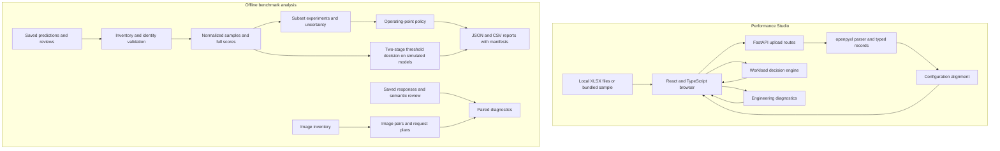
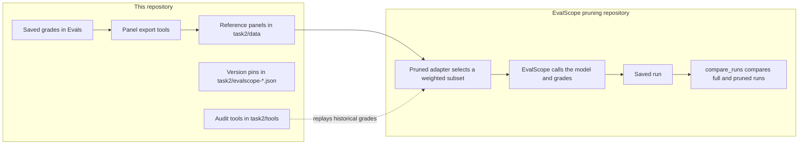
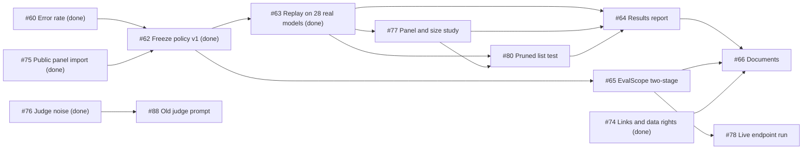

# Performance & Quality Lab

- **Live application:** [Performance Studio](https://ai-model-quality-challenge-rho.vercel.app/)
- **Benchmark runner:** [EvalScope pruning repository](https://github.com/sdv1708/evalscope-pruning). This repository is public.
- **Planned work:** [Known gaps and planned work](#known-gaps-and-planned-work)

Performance & Quality Lab supports two parts of model selection: serving performance and answer quality.
Performance Studio compares workbook projections against workload requirements.
The benchmark package tests how smaller question sets affect recorded quality scores and decisions.
The EvalScope pruning repository runs those smaller question sets against real model endpoints.

The web app and benchmark package run independently.
They share a repository, but they do not share an API, database, or runtime process.
The live application hosts Performance Studio. Benchmark analysis runs locally.

## Current status

This table gives the state of the project on 23 November 2026.

| Area                         | State                  | Result                                                                                                                                            |
| ---------------------------- | ---------------------- | ------------------------------------------------------------------------------------------------------------------------------------------------- |
| Performance Studio           | Complete and deployed  | Upload, compare, and evaluate workbook projections in the browser.                                                                                |
| Subset studies               | Complete               | No smaller tested subset passed every recorded policy gate. The recorded default keeps 315 of 315 and 100 of 100.                                 |
| Two-stage threshold decision | Policy v1 frozen       | Coverage, token cost, and error rate are measured on simulated models for both benchmarks. Fixed rules chose frozen policy v1 from these results. |
| Test on real models          | Replay passed          | Frozen policy v1 passed its 3 preregistered criteria on 28 unseen LiveCodeBench models. Near the threshold, most runs still need the full set.    |
| EvalScope integration        | Complete for one stage | Two pruned adapters and a run comparison tool work inside EvalScope. The two-stage mode is planned.                                               |
| Image-pair prototype         | Prototype              | Synthetic images and scripted answers only. No multimodal subset is validated.                                                                    |

The [planned work](#known-gaps-and-planned-work) section lists each open gap and the issue that addresses it.

## Start here

| Goal                                     | Document                                                                       |
| ---------------------------------------- | ------------------------------------------------------------------------------ |
| Install and use the project              | [Usage guide](USAGE.md)                                                        |
| Understand the system                    | [Architecture](#architecture)                                                  |
| Integrate the performance API            | [Backend reference](backend/README.md)                                         |
| Change the browser interface             | [Frontend reference](frontend/README.md)                                       |
| Understand benchmark methods and reports | [Benchmark reference](task2/README.md)                                         |
| Run the two-stage threshold decision     | [Usage guide: threshold decision](USAGE.md#run-a-two-stage-threshold-decision) |
| Understand the EvalScope work            | [EvalScope integration](#evalscope-integration)                                |
| Run the native EvalScope adapters        | [EvalScope pruning repository](https://github.com/sdv1708/evalscope-pruning)   |
| Understand performance assumptions       | [Performance design](docs/task1-analysis.md)                                   |
| Inspect model and workload estimates     | [Projection analysis](docs/task1-models-and-profiles.md)                       |
| Configure hosting                        | [Deployment guide](docs/vercel-deployment.md)                                  |
| Follow planned work                      | [Issue tracker](https://github.com/sdv1708/ai-model-benchmark/issues)          |

## Capabilities and scope

| Component                    | Implemented behavior                                                                                        | Interpretation                                                                                                                                |
| ---------------------------- | ----------------------------------------------------------------------------------------------------------- | --------------------------------------------------------------------------------------------------------------------------------------------- |
| Performance Studio           | Upload, align, and compare Excel projections. Evaluate workload requirements. Inspect trends and anomalies. | Results describe supplied projections. Production measurements require a separate load test.                                                  |
| Reference analysis           | Validate saved predictions and reviews. Reproduce six full benchmark scores.                                | No model endpoint is called.                                                                                                                  |
| Subset experiments           | Compare stratified subsets, weighted scores, model order, and threshold decisions.                          | Results apply to the supplied historical panel.                                                                                               |
| Operating-point analysis     | Select the smallest tested candidate that passes the configured policy.                                     | The recorded policy selects full retention: 315 coding tasks and 100 long-context questions.                                                  |
| Two-stage threshold decision | Run a stage-1 probe. Decide GO, NO GO, or ESCALATE. Grade the remaining questions on ESCALATE.              | The draft policy runs on simulated models only. A real-grade replay requires a frozen policy.                                                 |
| Image-pair prototype         | Create image variants, export request plans, and analyze saved responses.                                   | The demonstration uses synthetic images and scripted answers.                                                                                 |
| Native EvalScope integration | Preserve source pins, reference panels, export tools, and audit tools.                                      | Adapter implementations live in the [EvalScope pruning repository](https://github.com/sdv1708/evalscope-pruning). They are not included here. |

No smaller tested subset passed every recorded policy gate.
The project does not establish live inference savings or a validated multimodal subset.
The two-stage threshold decision is the planned route to a smaller probe with a stated error bound.

## Quick start

To use Performance Studio without installation, open the [live application](https://ai-model-quality-challenge-rho.vercel.app/).
To run the project locally, use Python 3.12, uv, and Node.js 24.x.
Run these installation commands from the repository root:

```powershell
cd backend
uv sync --locked
cd ../frontend
npm ci
```

In terminal 1, start the API from the repository root:

```powershell
cd backend
uv run uvicorn perf_api.main:app --reload --host 127.0.0.1 --port 8000
```

In terminal 2, start the browser server from the repository root:

```powershell
cd frontend
npm run dev -- --port 5173 --strictPort
```

Open [the local application](http://127.0.0.1:5173).
Select **Load sample workbook**.
The sample follows the same upload and validation path as a user file.

The [usage guide](USAGE.md) contains a worked comparison, API commands, benchmark commands, and fault recovery procedures.
Dependency installation requires network access or a prepared package cache.
Local app operation and saved-data analysis require no model API key.

## Architecture

### System boundaries



The browser sends HTTP requests to the Python API.
The API processes workbooks in memory and returns JSON.
The application code has no database, account system, or persistent upload store.
Browser state holds the active session; a page reload clears that session.

Benchmark commands read local files and write local reports.
They do not use the web API.
The image prototype exports future request bodies, but it does not send those requests.
The [EvalScope integration](#evalscope-integration) section describes the separate runner for live endpoints.

### Repository structure

```text
backend/
  src/perf_api/          HTTP routes, schemas, parser, and analysis functions
  tests/                 Parser, API, decision, comparison, and resilience tests
frontend/
  src/                   Upload flow, comparison view, decisions, and diagnostics
  public/sample/         Bundled workbook
  tests/                 Browser journeys, accessibility checks, and fixtures
task2/
  src/benchmark_reference/  Saved-data validation, subset studies, threshold decisions, and image tools
  data/                  Reference panels and the public-results question mapping
  policies/              Versioned threshold policies and the frozen-policy lock file
  tools/                 Audits, panel exports, source verification, and image demo
  tests/                 Synthetic fixtures and method checks
  evalscope-*.json       Version pins and EvalScope integration metadata
Evals/                   Saved benchmark artifacts managed through Git LFS
docs/
  data/                  Recorded summaries, manifests, and source audit results
  scripts/               Projection summary generation and the README link check
perf_data.zip            Supplied performance workbooks
vercel.json              Frontend and API service routing
USAGE.md                 Installation and operating procedures
```

The supplied performance workbooks, the bundled sample workbook, and the saved benchmark artifacts are public.
On 21 November 2026, the owner confirmed in [#74](https://github.com/sdv1708/ai-model-benchmark/issues/74#issuecomment-7068365711) that this data can stay public.

### Performance data flow

1. The browser submits one or more `.xlsx` files as multipart form data.
2. The parser reads the `Summary` worksheet and checks its required headers.
3. The parser fills merged scenario cells and converts each row into a `PerformanceRecord`.
4. The comparison function groups rows by matching configuration keys.
5. The browser displays matched rows, missing models, and upload diagnostics.
6. The decision engine evaluates complete rows against the selected workload requirements.
7. The engineering engine computes metrics, controlled trends, and anomaly evidence.

Model identity comes from the filename.
For example, `Model A profile 1.xlsx` gives model `Model A` and profile `1`.
Unrecognized filenames use the filename stem and profile `unknown`.
The parser does not contain a fixed model list.

The alignment key contains five fields:

```text
(profile_id, input_length, output_length, round(cache_percentage, 4), batch_size)
```

Rows with different keys remain separate.
A missing model appears as a coverage gap.
Identical duplicate sweeps collapse into one sweep.
Conflicting sweeps and sweeps with duplicate configuration keys are excluded with diagnostics.
Valid files can still load when another file fails.

### Performance modules

| Module                                  | Responsibility                                                        |
| --------------------------------------- | --------------------------------------------------------------------- |
| `frontend/src/App.tsx`                  | Coordinates uploads, active selections, and analysis state.           |
| `workbooks.ts`, `comparisons.ts`        | Define upload and comparison contracts and browser helpers.           |
| `ComparisonView.tsx`                    | Displays aligned configurations and coverage.                         |
| `DecisionView.tsx`, `decisions.ts`      | Collect requirements and display decision evidence.                   |
| `EngineeringView.tsx`, `engineering.ts` | Display diagnostic metrics, trends, and source references.            |
| `backend/src/perf_api/routes/`          | Accepts HTTP input and calls analysis functions.                      |
| `parser.py`, `schemas.py`               | Convert workbook bytes into typed projection records.                 |
| `comparison.py`                         | Aligns configurations and identifies duplicate or conflicting inputs. |
| `decision.py`                           | Evaluates workload constraints and selects a representative row.      |
| `engineering.py`                        | Computes diagnostics without changing or deleting projection rows.    |

HTTP routes handle transport and input validation.
Analysis functions operate on typed records without HTTP dependencies.
This separation permits direct tests of decision and comparison rules.

### Workload decisions

A scenario contains input tokens, output tokens, and cache fraction.
The API can omit scenario fields; omitted fields do not filter rows.
The browser requires a specific scenario for a multi-model comparison.
Requirements can specify capacity, generation speed, time to first token, context, and hardware cost.

| API status          | Display label | Rule                                                                              |
| ------------------- | ------------- | --------------------------------------------------------------------------------- |
| `go`                | GO            | At least one complete matching row meets every applicable check.                  |
| `no_go`             | NO GO         | Every matching row has at least one known failure.                                |
| `insufficient_data` | NEEDS DATA    | No requirements exist, no row matches, or a possible pass requires missing facts. |

Equality meets a limit.
The engine checks all applicable metrics on the same row.
It never combines one row's capacity with another row's latency.
The response includes every evaluated configuration and the representative row's evidence.
Workbook order resolves selection ties.

For example, a row can meet a capacity requirement and fail a latency requirement.
That row cannot support GO.
Another matching batch can support GO only if that complete row passes all checks.

Context support requires an explicit supported context window.
The required window is the larger of the requested minimum and the row's input-plus-output length.
A projected input length alone does not establish context support.

Hardware cost uses the following estimate:

```text
USD per million projected throughput tokens =
  box-hour price * 1,000,000 / (throughput_per_box * 3,600)
```

For example, a price of USD 4 per box-hour and capacity of 2,000 tokens/second gives approximately USD 0.556 per million tokens.
The estimate assumes sustained projected capacity.
It excludes idle time, software charges, and other operating costs.

### Engineering diagnostics

The engineering engine preserves reported metrics and adds derived ratios.
It compares batch sizes only when other scenario dimensions match.
It compares cache fractions only when the model, profile, lengths, and batch size match.

Anomaly rules identify inconsistent throughput components, negative values, and selected scaling drops.
Flags contain the rule and source record indices.
A flag requests investigation; it does not prove that a projection is incorrect.
Source indices identify normalized records, not original Excel row numbers.

### Benchmark data flow

The reference loader expects 28 prediction/review pairs across 56 files.
The coding and long-context panels contain three models each.
Each coding model has 315 tasks; each long-context model has 100 questions.
The MMMU reference contains 660 rows across 22 subjects for one model.
The full loader therefore validates 1,905 joined sample results.

The loader rejects missing partners, unexpected files, malformed grades, duplicate identities, and model mismatches.
Missing grades do not become zero scores.
Errors include source paths and line numbers.

| Module group                                                    | Responsibility                                                                                                                  |
| --------------------------------------------------------------- | ------------------------------------------------------------------------------------------------------------------------------- |
| `inputs.py`, `analysis.py`, `models.py`                         | Validate files, join predictions to reviews, and represent samples.                                                             |
| `pruning.py`, `long_context.py`                                 | Select stratified coding and long-context subsets.                                                                              |
| `experiments.py`, `transfer.py`                                 | Evaluate held-out models and independently held-out model pairs.                                                                |
| `uncertainty.py`, `study_metrics.py`                            | Compute intervals, ordering evidence, and threshold outcomes.                                                                   |
| `judge_noise.py`                                                | Report sensitivity to hypothetical changed judgments.                                                                           |
| `judge_items.py`, `judge_prompt.py`                             | Load the saved AA-LCR answers and build the two EvalScope judge prompts.                                                        |
| `judge_estimate.py`, `judge_run.py`                             | Write the cost estimate and collect judgments under an approved estimate.                                                       |
| `judge_report.py`, `judge_statement.py`, `judge_cli.py`         | Measure the judge noise and give it to the threshold report.                                                                    |
| `judge_compare.py`                                              | Compare the old one-word judge prompt with the JSON prompt and the saved grades (#88).                                          |
| `operating_points.py`                                           | Apply score, ordering, uncertainty, and decision gates.                                                                         |
| `threshold_policy.py`, `threshold_protocol.py`                  | Load a policy file, check the protocol of a frozen policy, record its hash, and enforce the frozen lock.                        |
| `threshold_rules.py`, `threshold_freeze.py`                     | Apply the fixed rules to a simulated run and write a new frozen policy version.                                                 |
| `threshold_benchmarks.py`                                       | Load each benchmark panel and give the strata of its stratifiers.                                                               |
| `threshold_simulation.py`                                       | Draw simulated models with a known full-set score.                                                                              |
| `two_stage.py`                                                  | Apply the stage-1 interval rule and the census on ESCALATE.                                                                     |
| `public_lcb.py`, `public_lcb_cli.py`                            | Fetch and check the public LiveCodeBench results, and map the 315 panel questions. Grades stay locked until a policy is frozen. |
| `threshold_tokens.py`, `threshold_cost.py`                      | Read token counts of saved answers and compute the expected cost.                                                               |
| `threshold_study.py`, `threshold_report.py`, `threshold_cli.py` | Write the decision table, summary, HTML report, and manifest. `threshold_frozen_report.py` adds the frozen-policy section.      |
| Reporting modules                                               | Write scores, selections, summaries, and manifests.                                                                             |
| `mmmu_images.py`                                                | Build normalized original images and controlled variants.                                                                       |
| `mmmu_requests.py`, `mmmu_measurements.py`                      | Export request plans and analyze saved paired attempts.                                                                         |

### Subset methods and uncertainty

Coding candidates group tasks by historical difficulty or reference response patterns.
Long-context candidates group questions by length and document count, or by length and historical difficulty.
The target model's grades do not enter its subset selector.
Pair comparisons exclude both compared models from selection inputs.

Each occupied stratum receives samples.
Population weights correct for different sampling rates between strata.
A raw subset average can give the wrong full-population estimate.
The [benchmark reference](task2/README.md#weighted-score-example) gives a numerical example.

The default experiments test retained fractions of 10%, 20%, 30%, 50%, and 100%, with twenty seeds.
A fraction describes the amount retained.
For example, 10% of 315 tasks retains 32 tasks after rounding upward.
Budgets that cannot cover every occupied stratum fail.

Intervals describe sampling uncertainty within the fixed recorded pool.
They do not measure future model behavior, generation variation, or judge randomness.
A threshold result is inconclusive when the interval crosses the threshold.
Full retention removes subset sampling error; it does not remove errors in recorded grades.

Reports use deterministic ordering and content hashes.
Each file is replaced atomically, and the manifest is written last.
Publication across several files is not a transaction.
A reader must check manifest hashes after an interrupted run.

### Two-stage threshold decision

The subset studies ask whether a small subset reproduces the full score.
The two-stage rule asks a narrower question: is the full-set score of this model at or above the customer threshold `t`?

1. Select a stage-1 probe with the policy stratifier. The selector uses reference grades only.
2. Compute a 95% interval for the full-set score from the probe grades.
3. If the lower bound is at or above `t`, decide GO and stop.
4. If the upper bound is below `t`, decide NO GO and stop.
5. Otherwise, decide ESCALATE. Grade the remaining questions and decide on the full set.

The full set has no sampling error, so ESCALATE always resolves.
A clear pass or a clear fail costs only the probe.
A model near the threshold costs the full benchmark.

A versioned policy file in `task2/policies/` holds the threshold, alpha, probe size, interval method, stratifier, and seeds.
The manifest records the SHA-256 of the exact policy file bytes.
The command refuses a replay on real grades unless the policy is marked frozen and its hash is committed in `policies/frozen-policies.json`.
Policy v1 is frozen (see [frozen policy v1](#frozen-policy-v1)).
The [benchmark reference](task2/README.md#two-stage-threshold-decision) gives the full rule and its limits.

## Recorded results

These scores describe saved artifacts, not current model endpoints.

| Benchmark        | Model        | Successful samples | Mean score |
| ---------------- | ------------ | ------------------ | ---------- |
| LiveCodeBench v5 | gpt-oss-120b | 241 / 315          | 0.765079   |
| LiveCodeBench v5 | kimi-k2.5    | 198 / 315          | 0.628571   |
| LiveCodeBench v5 | minimax-m2.5 | 195 / 315          | 0.619048   |
| AA-LCR           | gpt-oss-120b | 48 / 100           | 0.480000   |
| AA-LCR           | kimi-k2.5    | 66 / 100           | 0.660000   |
| AA-LCR           | minimax-m2.5 | 64 / 100           | 0.640000   |

The [recorded scores](docs/data/task2-full-scores.json) and [source manifest](docs/data/task2-manifest.json) identify the reference inputs.
The [operating-point results](docs/data/task2-operating-selected.json) retain the full recorded panels under the illustrative policy.
These results do not establish a generally sufficient benchmark size.

### Draft two-stage result on simulated models

The draft policy [`threshold-draft.json`](task2/policies/threshold-draft.json) has one section for each benchmark.
Its LiveCodeBench section uses threshold 0.70 and a 63-question probe (20% of 315).
The run draws 1,000 simulated LiveCodeBench models at each true score, 13,000 models in total.
"Decided at stage 1" is the fraction of models that got GO or NO GO from the probe alone.
A wrong decision differs from the decision on the full-set score.

| True score | Decided at stage 1 | Wrong decisions |
| ---------: | -----------------: | --------------: |
|       0.30 |              1.000 |         0/1,000 |
|       0.35 |              1.000 |         0/1,000 |
|       0.40 |              0.999 |         0/1,000 |
|       0.45 |              0.999 |         0/1,000 |
|       0.50 |              0.969 |         0/1,000 |
|       0.55 |              0.790 |         0/1,000 |
|       0.60 |              0.432 |         0/1,000 |
|       0.65 |              0.091 |         1/1,000 |
|       0.70 |              0.019 |         7/1,000 |
|       0.75 |              0.120 |         0/1,000 |
|       0.80 |              0.544 |         0/1,000 |
|       0.85 |              0.935 |         0/1,000 |
|       0.90 |              0.999 |         0/1,000 |

The probe decides at least 96.9% of models that are 0.20 or more from the threshold.
Near the threshold, most models escalate to the full set.
The highest wrong-decision rate is 7 of 1,000, at true score 0.70.

This result has two limits:

- The models are simulated. The generator uses the same reference difficulty as the stratifier, and this favors stratification. A second generator gives almost the same result (see [error rate and distance](#error-rate-and-distance-on-simulated-models)), but it also starts from the reference grades.
- The policy is a draft, not a frozen policy.

The same command runs the AA-LCR section: threshold 0.60 and a 20-question probe (20% of 100).
The probe decides 31.4% of 13,000 simulated AA-LCR models at stage 1, with 6 wrong decisions, all at true score 0.60.
The mean expected cost is 0.749 of a full run, against 0.452 for LiveCodeBench.
AA-LCR has only 100 questions, so its probe interval is wide and most models near the threshold escalate.
AA-LCR grades come from an LLM judge. The judge graded each saved answer 5 more times, and the judgments of 8 of 300 answers (2.7%) are not all equal.
No full-set decision at 0.60 changed between passes. The policy interval excludes this judge noise.
The majority of the new judgments gives each model a score 0.02 to 0.07 above its saved score. The [likely cause](task2/README.md#likely-cause-of-the-score-shift) is the judge prompt. Issue [#88](https://github.com/sdv1708/ai-model-benchmark/issues/88) tests it.
The [benchmark reference](task2/README.md#aa-lcr-on-the-draft-policy) gives the full AA-LCR result.

The published claim therefore stays full retention.
[#75](https://github.com/sdv1708/ai-model-benchmark/issues/75) prepared the public results of 28 real LiveCodeBench models, with the grades locked.
[#62](https://github.com/sdv1708/ai-model-benchmark/issues/62) froze policy v1 before anyone read a public grade, with the [disclosures](#frozen-policy-v1) below. [#63](https://github.com/sdv1708/ai-model-benchmark/issues/63) replayed it on those models one time. The [result](#real-replay-of-policy-v1) is below.
To reproduce the table, run the command in the [usage guide](USAGE.md#run-a-two-stage-threshold-decision).

### Token cost on simulated models

The same command gives every operating point a cost in tokens, from the saved answers of the three reference models.
A full LiveCodeBench run uses 4,532,328 tokens under the mean estimate (low 1,555,578, high 7,177,805), or 14,388 tokens for each answer.
A full AA-LCR run uses 96,162 tokens for each answer, 98% of them input.
These measured values replace the estimates in issue #58 (about 73,000 and 1,700 tokens), which the saved predictions do not support.
A run decided at stage 1 uses its probe; a run that escalates uses one full run.

| True scores  | Expected cost at 63 questions (share of a full run) |
| ------------ | --------------------------------------------------: |
| 0.30 to 0.50 |                                               0.204 |
| 0.55 to 0.65 |                                               0.650 |
| 0.70 to 0.75 |                                               0.944 |
| 0.80 to 0.90 |                                               0.338 |

The probe alone costs 0.199 of a full run.
Near the threshold, most runs escalate, so the rule costs almost a full run.
The [benchmark reference](task2/README.md#token-cost) gives the estimate, the cost curve for each stage size, and the cost of each interval method.

### Interval coverage on simulated models

The same command measures how often each interval method holds the full-set score.
For each true score (0.30 to 0.90 by 0.05), stage size (32, 63, 95, 158, and 221 questions), and stratifier, it draws 2,000 simulated models with new stratified subsets.
That gives 130 cells for each method.
A method passes a cell when its 95% interval holds the full-set score in at least 0.935 of the draws.

| Interval method      | Cells passed | Lowest coverage | Mean width |
| -------------------- | -----------: | --------------: | ---------: |
| Stratified Wilson    |   130 of 130 |          0.9625 |      0.159 |
| Pooled exact         |   130 of 130 |          0.9675 |      0.167 |
| Bonferroni exact     |   130 of 130 |          0.9990 |      0.349 |
| Stratified bootstrap |   103 of 130 |          0.8230 |      0.133 |

Of the methods that pass every cell, the stratified Wilson interval has the smallest mean width.
The Bonferroni reference is about twice as wide.
The bootstrap (Rao-Wu rescaling) fails 27 cells, all at 95 questions or fewer.
There, some strata hold one sampled question, or only passes, and add no bootstrap width.
The draft policy still names the pooled exact method.
Issue #62 chooses the method for policy v1 with a fixed rule.

### Error rate and distance on simulated models

The same command measures how often the probe decides wrong, and how far from the threshold a model must be for the probe to decide.
It uses two generators. The first is the Rasch-style generator of the earlier studies.
The second takes the real grades of one reference model and flips random grades until the pass count reaches the true score.
For each generator, the study runs 1,000 draws at each true score from 0.30 to 0.90 in steps of 0.01.
It covers every stratifier, interval method, and stage size of the draft policy: 40 settings for each benchmark.

A setting passes when its wrong-decision rate is at most 0.071 at every true score, for both generators.
The value 0.071 is 0.05 plus 3 standard errors at 1,000 draws.

| Benchmark                      | Settings that pass | Settings that fail                                      |
| ------------------------------ | -----------------: | ------------------------------------------------------- |
| LiveCodeBench (threshold 0.70) |           39 of 40 | Bootstrap interval, `response_stratified`, 32 questions |
| AA-LCR (threshold 0.60)        |           37 of 40 | Bootstrap interval at 12 and 20 questions               |

The pooled exact interval passes in every setting. Its highest wrong-decision rate is 0.020.

d95 is the smallest distance from the threshold at which the probe decides at stage 1 in at least 95% of the draws.
The table gives d95 for the stratifier and the interval method of the draft policy.

| LiveCodeBench probe |         d95 | AA-LCR probe |         d95 |
| ------------------: | ----------: | -----------: | ----------: |
|        32 questions | Not reached | 12 questions | Not reached |
|        63 questions |        0.19 | 20 questions | Not reached |
|        95 questions |        0.14 | 30 questions |        0.26 |
|       158 questions |        0.10 | 50 questions |        0.17 |
|       221 questions |        0.06 | 70 questions |        0.12 |

The 63-question LiveCodeBench probe decides at stage 1 for a simulated model that is at least 0.19 from the 0.70 threshold.
The 20-question AA-LCR probe of the draft policy does not reach d95 at any distance in the grid.
The two generators differ in d95 by 0.02 or less.

Both generators start from the reference grades, so a simulated model is not an unseen model.
The [replay on real models](#real-replay-of-policy-v1) uses the same pass rule.

### Frozen policy v1

Fixed rules chose the tuned values of [`threshold-v1.json`](task2/policies/threshold-v1.json) from the simulated results above.
The rules read no real grade, and nobody edited a chosen value by hand.
The author froze policy v1 before anyone read a public grade. Its SHA-256 is `2b9e1d771567788ad4ee9213ab09484b7d0dce81c884782d949d5dde2814f1a8`.

| Benchmark (threshold) | Interval method               | Stratifier              | Stage-1 size | Simulated d95 | Mean cost (share of a full run) |
| --------------------- | ----------------------------- | ----------------------- | -----------: | ------------: | ------------------------------: |
| LiveCodeBench (0.70)  | `stratified_wilson`           | `difficulty_stratified` |    63 of 315 |          0.18 |                           0.461 |
| AA-LCR (0.60)         | `pooled_exact_hypergeometric` | `metadata_stratified`   |    30 of 100 |          0.28 |                           0.636 |

- Interval method: the method that passes every coverage cell with the smallest mean width. For AA-LCR, Wilson is narrower but fails 1 of 130 cells, so pooled exact wins.
- Stratifier and stage-1 size: among the settings that pass the error-rate study for both generators, the lowest expected token cost under a uniform prior on true scores from 0.30 to 0.90. Each generator alone gives the same choice.
- The AA-LCR probe grows from 20 to 30 questions. Its stratifier does not use reference grades, so the simulation generator does not favor it.

The mean cost above comes from the error-rate study, which the rule reads: 1,000 draws at each true score from 0.30 to 0.90 in steps of 0.01.
A run of `threshold-decision` with v1 gives the decision study below: 13,000 simulated models for each benchmark, at true scores 0.30 to 0.90 in steps of 0.05.

| Result                                 | LiveCodeBench, draft | LiveCodeBench, v1 | AA-LCR, draft | AA-LCR, v1 |
| -------------------------------------- | -------------------: | ----------------: | ------------: | ---------: |
| Share decided at stage 1               |                0.684 |             0.695 |         0.314 |      0.557 |
| Wrong decisions                        |             8/13,000 |         11/13,000 |      6/13,000 |  12/13,000 |
| Highest wrong-decision rate            |                0.007 |             0.009 |         0.006 |      0.010 |
| Mean expected cost (share of full run) |                0.452 |             0.443 |         0.749 |      0.611 |

Every wrong-decision rate stays below the one-tail bound 0.025.
For AA-LCR, v1 decides 24 percentage points more models at stage 1, and its mean cost falls from 0.749 to 0.611 of a full run.
The [run record](docs/data/task2-threshold-v1-run.json) gives the manifest, the frozen-policy section, and the rule check: the rules, applied to the results of this run, give the v1 values again.
These are simulated models. The [real replay](#real-replay-of-policy-v1) is the test on real models.

Policy v1 also fixes the grade rule (`pass@1` of 50 or more), the replay settings, the random-probe baseline, the developer groups, the pruned-set test, every pass criterion, and the stated comparisons.
The [benchmark reference](task2/README.md#frozen-policy-v1) gives every value.

Three disclosures go with v1:

- The author saw a scratch replay on the 3 reference models before the freeze. The simulated choice reduces that bias, but it does not remove it.
- Before the freeze, the author read only these facts from the public panel: the file shape, the model names, and the count of each `pass@1` value. The author also read the question dates, difficulty labels, and platforms, and the `release_date` field. Nobody computed a score or a decision of a public model.
- The ordering criterion of the pruned-set test changed after the author saw the 3-model results. It now applies only to pairs with a gap of 0.10 or more. The author fixed it before anyone read a public grade.

The [replay report](docs/data/task2-real-replay/report.md#disclosures) adds a note to each disclosure.

### Real replay of policy v1

[#63](https://github.com/sdv1708/ai-model-benchmark/issues/63) ran frozen policy v1 one time on 28 public LiveCodeBench models.
None of them is in the reference panel that gives the strata.
Each model gets 1,000 decisions at each of 61 thresholds from 0.30 to 0.90: 1,708,000 decisions.
The policy fixed every setting and every pass criterion before the run.

| Pass criterion of v1                                 | Limit | Result | Mark |
| ---------------------------------------------------- | ----: | -----: | ---- |
| Highest wrong-decision rate of 1,708 cells           | 0.071 |  0.014 | Pass |
| Lowest coverage of 28 models                         | 0.935 |  0.950 | Pass |
| Mean expected cost at 0.70, as a share of a full run |   1.0 |  0.674 | Pass |

- Across all thresholds, the 63-question probe made 70.8% of the decisions. Of the 1,708,000 decisions, 601 were wrong. The mean expected cost was 0.433 of a full run.
- At 0.10 or more from the threshold, 0 of 1,206,000 decisions were wrong.
- At the primary threshold 0.70, the probe made 40.6% of the decisions. Of the 28 models, 19 have a full score within 0.10 of 0.70, and those models usually need the full set.
- The stratified probe is not better everywhere. At 0.70, the random probe made 42.3% of the decisions, and the stratified probe made 40.6%. The random probe made 84 wrong decisions of 28,000, and the stratified probe made 28.
- The real d95 is larger than the simulated d95. It is 0.195 over all thresholds, against 0.18. At 0.70 alone, no distance above the threshold reaches 95%.
- The AA-LCR evidence is weak. In the replay of the 3 reference models, the probe made 5 of 60 AA-LCR decisions. No decision was wrong.

The 28 models come from 9 developer groups, and they are not independent.
The 1,000 decisions of one model reuse the same grades.
The token cost is an estimate from the saved answers of the reference models.
The [replay report](docs/data/task2-real-replay/report.md) gives each model, each secondary result, and each limit.
The [manifest](docs/data/task2-real-replay/manifest.json) has SHA-256 `ed3c5bacb4b6b62695ee3b5e87d0b3f44e1b4deb4204f4f76da831b7fdc808d0`.
It records the command and commit `9a7ce058d0c98d02b2d347b457b7ba1bdb188a5b`.

## EvalScope integration

### What EvalScope is

[EvalScope](https://github.com/modelscope/evalscope) is the open-source LLM evaluation framework of the ModelScope community.
It loads benchmark datasets, sends prompts to a model endpoint, grades the answers, and writes reports.
It includes LiveCodeBench and AA-LCR, the two benchmarks of the subset studies.

### Why this project extends EvalScope

The `task2/` package works on saved grades and saved answers. It generates no model answer.
Only the [`aa-lcr-judge run`](task2/README.md#judge-noise-measurement) command calls a model, the AA-LCR judge. It needs an approved cost estimate.
To use a pruned benchmark on a new model, the subset selection must run inside a real evaluator.
The [EvalScope pruning repository](https://github.com/sdv1708/evalscope-pruning) adds that selection to EvalScope.
EvalScope continues to build prompts, call the model, run the coding sandbox, run the judge, and write reports.

The repository starts from upstream commit [`66f0945d145ce6c30de40253cd78144003c6f1fe`](https://github.com/modelscope/evalscope/tree/66f0945d145ce6c30de40253cd78144003c6f1fe).
It keeps the upstream Git history, the Apache-2.0 license, and the upstream attribution.
It is a derived repository, not a GitHub fork-network fork.

### What the EvalScope repository adds

| Addition                         | Purpose                                                                                                                    |
| -------------------------------- | -------------------------------------------------------------------------------------------------------------------------- |
| `live_code_bench_pruned` adapter | Selects LiveCodeBench coding questions by historical difficulty strata. It keeps the original grading tests.               |
| `aa_lcr_pruned` adapter          | Selects AA-LCR long-context questions by document length and difficulty strata. It uses an LLM judge.                      |
| Shared reference pruning         | Excludes the target model's grades, allocates the budget across strata, and records a weight for each selected question.   |
| `compare_runs` tool              | Reads a saved full run and a saved pruned run, checks that they match, and reports weighted scores, bounds, and decisions. |
| `pruning_smoke` dataset          | Provides a six-row synthetic dataset that tests the integration only.                                                      |
| Synthetic smoke example          | Runs the real evaluator against a local scripted model and judge, then compares the two saved runs.                        |

The adapters register through the normal EvalScope registry.
A user selects them with `--datasets live_code_bench_pruned` or `--datasets aa_lcr_pruned`.

### How the two repositories connect



1. The export tools build a reference panel from the saved grades. Each question has a SHA-256 fingerprint and the grades of the reference models.
2. The adapter matches every panel fingerprint to the public dataset before inference. A missing or ambiguous match stops the run.
3. The adapter removes the target model's grades from the selection inputs.
4. The selector gives each occupied stratum at least one question. It gives the remaining budget to strata in proportion to their size.
5. Each selected question carries a population weight. Reports give the weighted score.
6. `compare_runs` reads a full run and a pruned run, and reports whether they give the same decision.

The adapters reject `--limit`, because truncation makes the population weights wrong.

### Version pins and audit records

This repository keeps the records that tie each adapter to its exact source.

| File                                                               | Records                                                                                                                                                         |
| ------------------------------------------------------------------ | --------------------------------------------------------------------------------------------------------------------------------------------------------------- |
| [`evalscope-baseline.json`](task2/evalscope-baseline.json)         | Upstream commit and the `pruning_smoke` baseline. Issue [#18](https://github.com/sdv1708/ai-model-benchmark/issues/18).                                         |
| [`evalscope-lcb.json`](task2/evalscope-lcb.json)                   | Coding adapter commit, dataset revision, panel hash, and 1,200 loader parity cases. Issue [#19](https://github.com/sdv1708/ai-model-benchmark/issues/19).       |
| [`evalscope-aa-lcr.json`](task2/evalscope-aa-lcr.json)             | Long-context adapter commit, dataset revision, panel hash, and 100 unique source matches. Issue [#20](https://github.com/sdv1708/ai-model-benchmark/issues/20). |
| [`evalscope-compare-runs.json`](task2/evalscope-compare-runs.json) | Comparison tool commit, schema versions, and test counts. Issue [#21](https://github.com/sdv1708/ai-model-benchmark/issues/21).                                 |

`tools/audit_evalscope_lcb.py` and `tools/audit_evalscope_aa_lcr.py` replay the historical grades through the native loaders.
They require a checkout of the EvalScope pruning repository.
The [benchmark reference](task2/README.md#native-evalscope-boundary) describes these tools.

### Current EvalScope result and limits

The adapter default keeps 315 of 315 coding questions and 100 of 100 long-context questions.
This gives 0% sample saving, and it matches the operating-point result above.
Smaller ratios work, but they are experimental.

The project ran no paid benchmark inference through the adapters.
The verified runs are the synthetic smoke test and the replay of historical grades.
The saved AA-LCR runs have one judgment per answer. The [judge-noise measurement](task2/README.md#judge-noise-measurement) adds 5 judgments of each saved answer, and the policy interval excludes judge noise.

### Run the EvalScope smoke test

The smoke test needs Git, uv, Python 3.12, and network access to install packages.
It does not need a GPU, provider credentials, or paid model calls.
The [EvalScope pruning repository](https://github.com/sdv1708/evalscope-pruning) README gives the install commands.
Then run:

```powershell
.venv/Scripts/python.exe examples/aa_lcr_pruned/smoke.py --compare --work-dir outputs/smoke-demo
```

The command starts a scripted model and judge on `127.0.0.1`.
It runs the evaluator on 12 questions, then on a 3-question subset, and compares the two saved runs.
Exit code 0 means that the comparison succeeded.
Use a new `--work-dir` for each run, because the evaluator reuses cached results.

### Next EvalScope step

Issue [#65](https://github.com/sdv1708/ai-model-benchmark/issues/65) adds the two-stage mode to both pruned adapters.
The user runs a stage-1 probe and gets GO, NO GO, or ESCALATE.
On ESCALATE, the user runs the remaining questions.
`compare_runs` then reports the decision, the interval, the stage that decided, and the tokens used.
The mode reads its settings from frozen policy v1, which [#62](https://github.com/sdv1708/ai-model-benchmark/issues/62) froze.
Issue [#78](https://github.com/sdv1708/ai-model-benchmark/issues/78) then runs the mode on live model endpoints and measures the tokens and the cost.

## Image-pair prototype

The prototype creates variants through downsampling, blur, JPEG compression, occlusion, contrast changes, color changes, and text-region blur.
It preserves question text and changes one selected image slot per sample.
Content hashes bind image bytes, transformation settings, and pair identities.

Request plans exclude accepted answers.
Reports require saved responses and explicit semantic review states.
They separate correct answers, regressions, format failures, and missing attempts.
Missing-attempt bounds describe incomplete observations; they are not confidence intervals.

The [image harness reference](task2/MMMU_HARNESS.md) defines inputs and scoring.
The [research design](task2/MMMU_PROBE_DESIGN.md) describes the larger proposed study.
The supplied MMMU reference does not represent the full dataset inventory.

## Known gaps and planned work

The recorded studies leave the gaps below.
Each open issue addresses one gap.
All issues are in the [issue tracker](https://github.com/sdv1708/ai-model-benchmark/issues).

### Gaps with planned work

| Gap                                                                       | Planned work                                                                                                                                         |
| ------------------------------------------------------------------------- | ---------------------------------------------------------------------------------------------------------------------------------------------------- |
| The effect of the reference panel and of the benchmark size is not known. | [#77](https://github.com/sdv1708/ai-model-benchmark/issues/77) holds out one developer group at a time, on 315 and on 1,055 questions.               |
| No fixed pruned list is validated as a score estimator.                   | [#80](https://github.com/sdv1708/ai-model-benchmark/issues/80) tests fixed lists of 95 and 158 LiveCodeBench questions on the 28 models.             |
| The EvalScope adapters run one stage only.                                | [#65](https://github.com/sdv1708/ai-model-benchmark/issues/65) adds the two-stage mode to both adapters and to `compare_runs`.                       |
| The project measured no live inference saving.                            | [#78](https://github.com/sdv1708/ai-model-benchmark/issues/78) runs the two-stage mode on live model endpoints and measures tokens, time, and cost.  |
| The cause of the AA-LCR judge shift is not tested.                        | [#88](https://github.com/sdv1708/ai-model-benchmark/issues/88) sends the 300 saved answers to the judge with the old one-word prompt.                       |
| The results are spread across JSON and CSV files.                         | [#64](https://github.com/sdv1708/ai-model-benchmark/issues/64) publishes one self-contained HTML results report, linked from the top of this README. |
| The documents state the full-retention result.                            | [#66](https://github.com/sdv1708/ai-model-benchmark/issues/66) updates every document with the frozen v1 result.                                     |

The [real replay](#real-replay-of-policy-v1) passed every criterion.
Full retention stays the claim for a score estimate, because no fixed pruned list is validated.

Two issues are deferred.
[#61](https://github.com/sdv1708/ai-model-benchmark/issues/61) adds cost-aware Neyman allocation as a selector; policy v1 chooses from the existing stratifiers only.
[#67](https://github.com/sdv1708/ai-model-benchmark/issues/67) adds a read-only **Benchmark results** tab to Performance Studio.

### Order of work



Issues #56 to #60, #62, #63, and #74 to #76 are complete.
Issues #78 and #88 need a model endpoint key and an approved cost estimate.

### Limits with no planned work

- AA-LCR has no public per-question results. No test on unseen models and no pruned list exist for AA-LCR.
- The image-pair prototype uses synthetic images and scripted answers. No multimodal subset is validated.
- Performance Studio results describe supplied projections. Production capacity requires a separate load test.

## Development and deployment

The [usage guide](USAGE.md#verification) lists tests, static checks, build commands, and the README link check.
Python tests cover pure functions and HTTP boundaries.
Browser tests cover uploads, customer decisions, engineering evidence, recovery, and accessibility scans.
Synthetic benchmark fixtures provide known expected answers.

Local development uses a Vite proxy for `/api` requests.
The configured Vercel deployment builds separate frontend and backend services under one domain.
`/api/*` and `/health` reach the backend; remaining paths reach the frontend.
The [deployment guide](docs/vercel-deployment.md) describes configuration and verification.

The app has no authentication, durable sessions, or application-level upload size limits.
The Python process reads uploaded workbooks into memory.
Production capacity and resource limits require separate validation.

## Terminology and documentation

| Term              | Meaning                                                                                                   |
| ----------------- | --------------------------------------------------------------------------------------------------------- |
| Projection        | A supplied performance estimate.                                                                          |
| Sweep             | One model/profile workbook with several configurations.                                                   |
| Configuration     | One scenario and batch size.                                                                              |
| Capacity          | Aggregate projected throughput in tokens/second.                                                          |
| Generation speed  | Output tokens/second for one user.                                                                        |
| TTFT              | Time to first token, measured in milliseconds.                                                            |
| Stratum           | A group of questions with shared selection characteristics.                                               |
| Retained fraction | The proportion of the original question set selected.                                                     |
| Operating point   | A candidate method and retained size evaluated against a policy.                                          |
| Percentage point  | An absolute difference between percentages; 60% to 63% is three percentage points.                        |
| Reference panel   | The question fingerprints and historical grades that an EvalScope adapter uses for selection.             |
| Stage-1 probe     | The first, smaller set of questions in the two-stage rule.                                                |
| ESCALATE          | The two-stage result when the probe interval crosses the threshold.                                       |
| Census            | A run on every remaining question. It has no sampling error.                                              |
| Frozen policy     | A policy file whose hash is committed. Only a frozen policy can run on real grades. Policy v1 is frozen.  |
| d95               | The smallest distance from the threshold at which the stage-1 probe decides in at least 95% of the draws. |

The documentation uses ASD-STE100 writing principles: short sentences, active voice, consistent technical names, and ordered procedures.
Software identifiers and benchmark names retain their exact spelling.
The [official ASD-STE100 specification](https://www.asd-ste100.org/assets/files/ASD-STE100_ISSUE9.pdf) defines the writing rules and controlled vocabulary.
This documentation does not claim independently audited conformity.
