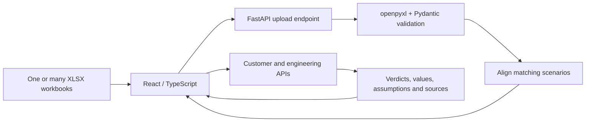

# Explain Performance & Quality Lab, from first principles to interview depth

Read this beside the [portfolio tour](PORTFOLIO.md). You can learn and demonstrate
the entire project without making a video. The project started from supplied
challenge briefs; your current goal is a personal portfolio, not compliance with
their submission process.

## 1. Two questions about a robot

Imagine choosing a robot for a busy library. First: can it help enough people
quickly? Second: does it give good answers? A very fast robot that gives wrong
answers is not useful. A correct robot that makes everyone wait may also fail.

Performance Studio studies the first question using spreadsheets of projected
performance. The evaluation work studies the second using saved answers and
grades. They are related business questions, but they use different data.
There is no measured joint speed-quality frontier for the same identified
models here: Task 1 uses anonymous letters, Task 2 uses named saved models.

**Interview version:** "I built a model-selection project that separates serving
capacity from answer quality. One part explains performance projections through
a deployed application; the other investigates evaluation fidelity through
reproducible analysis and native framework integration."

## 2. Follow one spreadsheet through the application

Think of a restaurant. The browser is the menu and waiter. The API is the order
counter. The parser reads the recipe card. Typed records are clean, labelled
ingredients. Decision functions apply the rules. The response brings back the
decision and its reasons.



The parser requires a `Summary` sheet, headers on row 2, and the documented
columns. It reads values with openpyxl; it does not run Excel to recalculate
formulas. The forward-filled input/output/cache values account for merged
scenario cells. Validation checks required values and returns recoverable
workbook errors. Model/profile names come from filenames, rather than a fixed
list of A through K. A conforming Model L therefore needs no code change.

Pydantic models define the data crossing Python boundaries and the HTTP API.
TypeScript describes the browser-side shape. Static types catch many mistakes
before execution; runtime validation checks the bytes that actually arrive.
Neither eliminates the need to test numerical behavior.

The comparison API aligns profile, input length, output length, cache fraction,
and batch size. Comparing different workloads as if they were identical would
be like comparing a bicycle going downhill with a bus going uphill.

The browser holds the workspace in page memory. Uploads do not become a saved
project in an application database. Reloading discards the page state. Hosting
is one Vercel origin: static frontend plus Python service; `/api/*` requests go
to FastAPI. Local Vite development uses a proxy. Same-origin routing keeps the
browser integration simple. The deployed serverless platform has payload limits;
this is not unlimited or streaming ingestion.

**Code to explain:** [parser](../backend/src/perf_api/parser.py),
[comparison](../backend/src/perf_api/comparison.py),
[decision rules](../backend/src/perf_api/decision.py),
[engineering rules](../backend/src/perf_api/engineering.py),
[browser entrypoint](../frontend/src/App.tsx).

## 3. Learn the units before discussing speed

| Term               | Child-sized explanation                          | Engineering meaning                                          |
| ------------------ | ------------------------------------------------ | ------------------------------------------------------------ |
| Token              | A small piece of a word                          | Model text unit; tokens are not always whole words           |
| Throughput         | How many pieces the whole shop makes each second | Aggregate projected tokens/second                            |
| Generation speed   | How fast one person's answer grows               | Output tokens/second/user                                    |
| TTFT               | How long until the robot starts talking          | Time to first token, displayed in milliseconds               |
| Batch size         | How many jobs work together                      | A serving configuration that can change capacity and latency |
| Per-box throughput | Work done by one machine                         | Normalized capacity; hardware assumptions still matter       |
| Cache fraction     | How much familiar material can be reused         | A projection input; not a measured customer hit rate         |
| Context window     | How much the robot can hold in mind              | Supported token budget, supplied explicitly when needed      |

At 100 output tokens/second, 500 output tokens take roughly five seconds of
generation, plus waiting/prefill and other overhead. That arithmetic is an
illustration, not a response-time model implemented or validated by this app.

More total throughput does not automatically mean a faster answer for one user.
Different hardware allocations can inflate totals, which is why the engineering
view also reports per-box values. Total divided by per-box is an observed ratio,
not independent proof of the physical machine count.

## 4. Explain GO, NO GO, and NEEDS DATA

Suppose the requirement is capacity at least 400,000 tokens/second, generation
speed at least 1,200 tokens/second/user, and TTFT at most 10 milliseconds.
The app checks each matching projected row as a complete configuration.

- **GO:** at least one row satisfies every applicable check with no unknowns.
- **NO GO:** every matching row has a known failed check.
- **NEEDS DATA:** no matching scenario, no supplied thresholds, or an unresolved
  assumption leaves a possible pass unconfirmed.

The app cannot take capacity from batch 40 and latency from batch 10 to invent
a passing batch that does not exist. It returns the first passing row in workbook
order; it does not solve an optimization problem for the best configuration.
When every row fails, it shows the row with the fewest failed checks, with
source-order ties, while retaining evidence for all matching rows.

In the supplied A/C profile-1 example, Model A passes at batch 20 and C fails.
This supports a decision **under those projections and targets**. It is not a
production SLA, a model-quality comparison, or a guarantee about tail latency.

Missing pricing stays unknown. With a declared $2/box-hour and projected capacity
of 1,000 tokens/second/box, the illustrative hardware cost is:

```text
2 dollars/hour * 1,000,000 tokens / (1,000 tokens/second * 3,600 seconds/hour)
= about 0.556 dollars per million projected throughput tokens
```

That assumes sustained utilization and excludes idle time and other expenses.
Input plus output length is a scenario requirement, not evidence of a model's
maximum supported context.

## 5. Why the framework choices make sense

React/TypeScript handles shared upload state, selectors, comparisons, and
independent loading/error states. Vite supplies the small SPA toolchain.
FastAPI/Pydantic supplies a typed HTTP boundary; openpyxl reads Excel in Python.
The trade-off is maintaining two languages and coordinating contracts.

Streamlit could shorten a Python-only prototype. Next.js could help if server
rendering, accounts, or SEO became relevant. Browser-only spreadsheet parsing
could remove a Python service, while moving validation and numerical logic to
JavaScript. These are design alternatives, not measured superiority claims.

Accounts, persistence, interpolation, automatic pricing, and production telemetry
were cut to focus on the upload-to-decision workflow. With more time, the most
valuable next step is comparing projections with real serving measurements,
including tail latency and headroom, rather than adding unsupported conclusions.

## 6. The short-exam problem

Imagine testing three robots with 315 coding questions and 100 book-reading
questions each. Running the whole exam can be expensive. A pruner chooses a
shorter exam before the candidate answers. The question is whether that shorter
exam supports the same useful decision.

First establish the full-score baseline. Saved predictions and reviews join on
`index` within their benchmark/model/subset context. A row number from another
file is not enough. Missing, duplicate, or incompatible evidence must not become
an invented zero or a silently smaller denominator.

| Saved model  | Coding           | Long-context |
| ------------ | ---------------- | ------------ |
| gpt-oss-120b | 241/315 = 76.51% | 48/100 = 48% |
| kimi-k2.5    | 198/315 = 62.86% | 66/100 = 66% |
| minimax-m2.5 | 195/315 = 61.90% | 64/100 = 64% |

These are stored-artifact grades, not current endpoint measurements. The data
inventory validates 28 prediction/review pairs, 56 files, and 1,905 samples
including 660 MMMU references. The Part A scores above use coding and AA-LCR.

## 7. Baskets, weights, and leakage

**Stratification means baskets.** Coding groups questions using difficulty from
other historical models' pass counts. AA-LCR also uses token-length thirds.
Reserve coverage for occupied groups, allocate remaining slots, and use stable
seeded hash priorities within groups. Population-wide uniform random selection,
easiest-only and hardest-only appear as comparison baselines, not the supported
structured strategy. A hash provides reproducibility; it does not itself provide
representativeness.

**Weights restore the original basket sizes.** Suppose the full population has
two diagram questions and six text questions. Keep one from each group. If the
diagram answer fails and the text answer passes, the selected plain average is
50%. The population-weighted estimate is:

```text
(2/8 * 0) + (6/8 * 1) = 75%
```

Each selected item in group h gets weight `N_h / (N * n_h)`: group population,
divided by total population times selected group size. This corrects group
allocation, subject to the selection assumptions. It cannot fix every bias in
the reference models or prove transfer to future model families.

**Leakage means peeking at the answer.** A candidate's grades must not choose its
own exam. Target model identities are excluded; aliases need explicit exclusions
when canonical identities cannot be inferred. Leave-one-model-out testing builds
selection using other models and evaluates the held-out model. Pair holdouts
stress ordering. Three related saved models are limited evidence; choosing the
policy after inspecting these results reuses evaluation evidence. The next
credible confirmation needs a frozen policy and an untouched model.

## 8. What makes a short exam acceptable?

Several checks ask different questions:

| Check                        | What it asks                                                   |
| ---------------------------- | -------------------------------------------------------------- |
| Absolute score error / MAE   | How far is the short-exam estimate from the full score?        |
| Ordering                     | Does it prefer the same model, especially for close pairs?     |
| Threshold agreement          | Does it give the same good-enough decision?                    |
| Uncertainty and decisiveness | Is the evidence narrow enough to make that decision?           |
| Seed stability / overlap     | Does a different selected set change the result substantially? |

A two-point change can flip a decision near the threshold. A small average error
can hide a bad fold or unstable ordering. Twenty seeds are twenty selections,
not twenty independent model families. Nominal finite-pool intervals describe
fixed recorded grades under sampling assumptions; they do not simultaneously
guarantee every searched method and ratio.

The illustrative policy tests retained ratios 0.1, 0.2, 0.3, 0.5, and 1.0.
**Only 1.0 passes every gate: 315/315 coding and 100/100 AA-LCR.** That means
0% demonstrated sample saving. It does not prove every possible smaller method
or every untested size would fail. This is a useful negative result and a tested
fallback; the original ambition of validated compression remains unachieved.

`prune_ratio` is the fraction **kept**, despite the name. Keeping half of 315
rounds up to 158. Do not describe 1.0 as "prune everything."

## 9. The judge is another robot

Coding grades come from executable tests. AA-LCR uses an LLM judge. Rejudging
the same answer might produce a different grade; generating a new answer adds
another source of variation. One saved verdict per answer cannot identify judge
variance. Resampling questions does not create repeated judge evidence.

Full retention removes missing-question sampling error in the recorded pool.
It does not remove judge mistakes, generation variability, or future workload
shift. Next collect repeated independent judgments of fixed answers, repeated
candidate generations, and human audits of ambiguous cases.

## 10. Why the native integration matters

A standalone analysis can select indices without improving an evaluation
framework. The native implementation instead registers
`live_code_bench_pruned` and `aa_lcr_pruned` with EvalScope. Both use a shared
`ReferencePruningAdapter` at `DefaultDataAdapter.load_subset`.

That seam sees the whole question population before repeats and expensive model
calls. Per-row conversion alone cannot allocate a population budget. The
framework continues to own prompts, model transport, coding sandbox/LLM judge,
and saved reports. Fingerprints bind historical identities to question content;
reordering must not accidentally select a different question with the same row
position. Incomplete grading fails closed rather than renormalizing surviving
answers into an optimistic score.

The upstream base is `66f0945d145ce6c30de40253cd78144003c6f1fe`.
The audit pins the separately tested native main. Exact commits are like exact
book editions: APIs and flags can change. At this pin use `--work-dir` and
nested `dataset_args.<dataset>.extra_params`; the original brief's conceptual
`--output` example is not the literal command contract.

The [native runbook](../task2/ISSUE_26_GUIDE.md) has install/demo commands.
It requires private-source access. This public repo's `task2` installation
reproduces analysis; it does not install the native adapters by itself.

## 11. Why 100% can still mean inconclusive

The credential-free native demo uses a scripted candidate and judge on synthetic
questions. All twelve full-run answers pass; all three selected answers pass.
The score difference is zero. But the short run knows only three answers:

```text
Worst complete result: 3 passes / 12 questions = 25%
Best complete result: 12 passes / 12 questions = 100%
Requirement: 80%
```

The requirement sits inside the possible range, so the subset is inconclusive.
The comparator does not borrow the nine unseen full-run grades to make the short
run certain. These are deterministic completion bounds, not a 95% statistical
interval. GO requires the whole bound at or above the threshold; NO GO requires
the whole bound below; otherwise gather more evidence. Exit code zero means
valid processing, not approval. A benchmark GO still needs customer-task and
serving validation before a deployment decision.

The fixture demonstrates framework wiring, serialization and comparison. Its
12-to-3 reduction is not evidence of production savings.

## 12. A picture-reading experiment

Now imagine the robot must read tiny labels on a chart. A wrong answer might
come from bad eyesight, bad reasoning, image resizing, or how vision and text
are combined. A single wrong answer does not tell us which one.

The proposed MMMU study uses the full pinned inventory: 11,550 questions across
30 subjects, rather than only the 660 supplied references. The official split
counts are 150 development, 900 validation and 10,500 test.
[Official MMMU source](https://raw.githubusercontent.com/MMMU-Benchmark/MMMU/268471d0d488258990025331c7528359c324aa25/README.md).

Cover tiny text, chart lines, diagrams, spatial detail, clutter, color and domain
images. Pair originals with controlled, human-checked changes that preserve the
answer. Hold prompts/settings fixed and interleave conditions. No-image controls
test visual dependence; equivalent factual text tests reasoning when perception
is supplied; visual-fact extraction tests what was perceived. Keep deliberately
destructive controls separate from answer-preserving robustness evidence.

The proposal separates a weighted population panel from extra diagnostic cases.
Its budgets require feasibility and power checks. An OpenAI-compatible API exposes
the whole visual path, so the result could show visual-path sensitivity. To claim
the **encoder alone** caused the change, change only the encoder and control the
rest. The existing harness validates synthetic mechanics, not a live quality
result. Full design: [MMMU proposal](../task2/MMMU_PROBE_DESIGN.md).

## 13. Rehearsal without a recording

Use three passes. First explain the robot/library story in 30 seconds. Then draw
both data flows in three minutes. Finally answer these without opening the guide.
Only mark a row complete after you can explain it and handle its follow-up.

| Prompt                                     | A sufficient answer must include                                                       | Follow-up to practise                            |
| ------------------------------------------ | -------------------------------------------------------------------------------------- | ------------------------------------------------ |
| What problem did you solve?                | Separate performance feasibility and quality evidence; two audiences                   | Why not a single overall model ranking?          |
| How does an unseen workbook work?          | File/column contract, derived identities, validation, runtime parsing                  | What if a formula has no cached value?           |
| What makes GO honest?                      | One complete matching row meets every check; assumptions explicit                      | Why not choose each metric's best row?           |
| Why NEEDS DATA?                            | Unknown differs from failed; missing targets/scenario/pricing/context                  | Can NO GO coexist with other unknown checks?     |
| How is the app deployed?                   | One origin, static frontend/Python service, proxy locally, page state                  | What changes for large persistent uploads?       |
| How did you shorten the benchmark?         | Structured selection implemented; no smaller validated default                         | Why is 0% saving still worth showing?            |
| Why weights?                               | Correct population shares after unequal allocation; work 2/8 versus 6/8                | What can weights not fix?                        |
| How do you avoid peeking?                  | Exclude target grades, handle aliases, holdouts, freeze future validation              | Why are existing holdouts insufficient proof?    |
| Why can a tiny error be bad?               | A near-threshold decision or close model order can flip                                | Why examine worst folds rather than only means?  |
| How did you measure judge noise?           | You could not identify it from one verdict; propose repeated judging                   | How differs from repeated candidate generation?  |
| Why inside EvalScope?                      | Registered adapters, whole-pool selection before inference, native grading             | Why is a standalone script insufficient?         |
| Why is perfect demo accuracy inconclusive? | Three known passes, nine unknown; 25%-100% at 80%                                      | Is that bound a confidence interval?             |
| Is the image encoder bad?                  | Proposed controls, synthetic harness, visual-path versus encoder causality             | What intervention would isolate the encoder?     |
| What would you improve?                    | Untouched-model validation, repeated judging, measured costs, real serving calibration | Which one reduces the biggest uncertainty first? |

For the NO GO follow-up: if every eligible row has a known failure, other unknown
checks cannot turn those rows into passes; missing information does not erase a
known failure. For the formula follow-up: this parser reads cached values and
requires usable numeric cells; it is not an Excel calculation engine.

Your next rehearsal exercise is to explain the 75% weighted example and the
25%-100% bound aloud, then point to the source/evidence for each. This audit
prepares the rehearsal; it does not claim you have completed it or can yet answer
every question independently.

## 14. Claims to avoid and what to say instead

| Avoid                                             | Defensible wording                                                                                        |
| ------------------------------------------------- | --------------------------------------------------------------------------------------------------------- |
| "I cut evaluation cost by 75%."                   | "A synthetic fixture keeps 3/12; real validated savings are not established."                             |
| "I found the smallest possible benchmark."        | "Full retention was the smallest passing size among the tested candidates."                               |
| "This predicts production performance."           | "It explains supplied projections; production calibration remains future work."                           |
| "I identified the hidden model parameter counts." | "I formed conditional serving-burden hypotheses; hardware and architecture confound size."                |
| "The multimodal test proves encoder quality."     | "The proposed paired controls diagnose visual-path sensitivity; the full study is unrun."                 |
| "I wrote EvalScope / all source data."            | "I built an AI-assisted project and extension on EvalScope and supplied data, with provenance preserved." |
| "Everything is publicly reproducible."            | "The main project is public; the native companion currently requires private access."                     |

For deeper reading use [Task 1 design](task1-analysis.md),
[model/profile interpretation](task1-models-and-profiles.md),
[Part A policy walkthrough](../task2/ISSUE_17_GUIDE.md),
[comparison walkthrough](../task2/ISSUE_21_GUIDE.md), and the
[verification record](issue-27-evidence.md).
