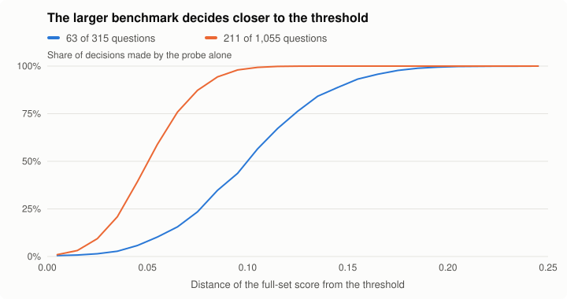

# Results: a small probe for score-threshold decisions

**Question.** Does a model score at or above a threshold? A full benchmark run answers it, but it is expensive.

**Method.** Grade a small probe first. If its 95% interval is on one side of the threshold, stop with GO or NO GO. If not, grade the full set. The probe is stratified by question difficulty, which comes from other models only.

**Test.** [Policy v1](../task2/policies/threshold-v1.json) was frozen, with every pass criterion, before anyone computed a score of a test model. The test models are 28 public LiveCodeBench models from 9 developers. Each model gets 1,000 different probes. Each probe decides at 61 thresholds from 0.30 to 0.90.

## Headline

- **315 questions (#63, the preregistered unseen-model test):** over all thresholds, the mean cost was 43.3% of the estimated tokens of a full run, with 601 wrong of 1,708,000 decisions. At 0.10 or more from the threshold, 0 of 1,206,000 decisions were wrong.
- **1,055 questions (#77, strata from other public models):** at threshold 0.70, a probe of 211 questions made 82.7% of 28,000 decisions. Full runs for the other decisions included, the mean cost was 33.8% of the questions. Wrong decisions: 1. A random probe of the same size made 25 wrong decisions.
- **Hard case:** at threshold 0.70 on 315 questions, the probe made 40.6% of the decisions, at 67.4% of the tokens. There, 19 of 28 models score within 0.10 of the threshold.

## Pass criteria

Every run passed every criterion of the frozen policy.

| Run | Questions | Strata from | Highest wrong-decision rate (limit 0.071) | Lowest coverage (limit 0.935) | Mean cost at 0.70 (below 1) | Mark |
| --- | --- | --- | ---: | ---: | ---: | ---: |
| [#63](https://github.com/sdv1708/ai-model-benchmark/issues/63) | 315 | 3 reference models | 0.014 | 0.9500 | 0.674 | Pass |
| [#77](https://github.com/sdv1708/ai-model-benchmark/issues/77) | 315 | public models | 0.008 | 0.9740 | 0.676 | Pass |
| [#77](https://github.com/sdv1708/ai-model-benchmark/issues/77) | 1,055 | public models | 0.008 | 0.9795 | 0.338 | Pass |

A cost is a share of a full run. The 315-question costs are estimated tokens. The 1,055-question cost is in questions, because the public file has no token counts.

## Stratified probe against random probe

| Questions | Probe | Decided at 0.70 | Wrong of 28,000 | Decided, all thresholds | Wrong of 1,708,000 | Mean cost in questions |
| --- | --- | ---: | ---: | ---: | ---: | ---: |
| 315 | Stratified probe, 3 reference models | 40.6% | 28 | 70.8% | 601 | 0.434 |
| 315 | Stratified probe, public models | 40.3% | 10 | 70.7% | 130 | 0.434 |
| 315 | Random probe | 42.3% | 84 | 69.2% | 1,645 | 0.447 |
| 1,055 | Stratified probe, public models | 82.7% | 1 | 84.1% | 103 | 0.327 |
| 1,055 | Random probe | 81.1% | 25 | 83.6% | 1,070 | 0.331 |

- **Larger reference panel:** the strata come from the public models of other developers, never from the developer of the test model. Wrong decisions fall from 601 to 130. The cost does not fall.
- **Where random is better:** at 0.70 on 315 questions, the random probe decides more (42.3%). It also makes more wrong decisions (84). In each arm, it decides more at less than 0.05 from the threshold.

## Benchmark size

<picture>
  <source media="(prefers-color-scheme: dark)" srcset="results-distance-dark.svg">
  
</picture>

At 0.05 to below 0.10 from the threshold, the stratified probe decides 25.4% with 63 of 315 questions and 82.0% with 211 of 1,055. [`distance.csv`](data/task2-panel-study/distance.csv) holds the plotted values.

## LLM-judge reliability (AA-LCR)

- The judge graded 300 saved answers 5 more times. The verdicts of 8 answers (2.7%) were not all equal. No GO or NO GO decision at 0.60 changed.
- The new scores were 2 to 7 points above the saved scores. All 13 changed verdicts went from INCORRECT to CORRECT.
- A control run with the old one-word prompt made 10 of the 13 INCORRECT again. By the rule fixed before that run, the prompt explains most of the shift. 10 is the lowest count for that conclusion, and one control run does not separate the prompt from the date and the endpoint.

## Limits

- The 28 models are not independent, and the 1,000 probes of one model reuse the same saved grades. The test measures question selection, not the variance of new answers.
- The average over all thresholds includes thresholds far from a score, which are easy.
- The token costs are estimates from the saved answers of 3 models. No live inference saving is measured yet.
- The two sizes differ also in the questions, the probe size, and the scores. Within 0.10 of 0.70 there are 19 models on 315 questions and 10 on 1,055.
- The #77 settings were frozen, but its code was written after the #63 result was known. The code chose two points that the policy leaves open.
- The random probe uses another interval method than the stratified probe, as the policy fixes. The gap is not from question selection alone.
- The probe answers a threshold question. No fixed smaller question set is validated as a score estimator.

## Evidence

- Reports: [unseen-model replay](data/task2-real-replay/report.md), [reference-panel study](data/task2-panel-study/report.md), [judge noise](data/task2-aa-lcr-judge-rerun/report.md), [judge-prompt control](data/task2-aa-lcr-judge-one-word/report.md).
- Code and method: [benchmark reference](../task2/README.md). EvalScope adapters: [evalscope-pruning](https://github.com/sdv1708/evalscope-pruning).
- Source of the public grades: [LiveCodeBench](https://livecodebench.github.io/performances_generation.json). The repository holds derived values only.
- [`build_results_page.py`](../task2/tools/build_results_page.py) builds this page from the recorded data, and a test checks it.
