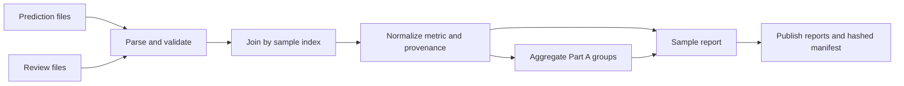

# Issue #14: implementation and interview guide

This ticket establishes a reproducible full-data reference for later benchmark
compression. Read the modules in the order below. Commands and actual scores are
in [README.md](README.md); verification is in [issue-14-evidence.md](../docs/issue-14-evidence.md).

## The problem and scope

The customer's product depends on code generation and long-context reasoning.
Later we will select fewer benchmark tasks while preserving useful model comparisons
and deployment decisions. First we need trustworthy full-data scores. If grades
are attached to the wrong answers, every pruning experiment is invalid.

This ticket calculates recorded grades. It does not rerun inference, execute
candidate code, rejudge answers, select a subset, or invent a customer threshold.
The ultimate pruner must live inside a pinned evalscope fork. This package is the
experimental reference, not that final framework extension.

## 1. Contracts — models.py

`Source` records a file and one-based line number. `JsonlRow` attaches that location
to a parsed object. `FilePair` declares the benchmark, model, subset, metric, count,
and paired paths. `SampleResult` is a normalized grade with provenance.
`BenchmarkSummary` contains a count, sum, and equal-weight mean.

Full identity is **benchmark/model/subset/index**. Index 0 can recur across
benchmarks, models, and MMMU subjects. An index is not a line position: files can
arrive in different orders.

Dataclasses make contracts explicit without adding runtime dependencies.
`frozen=True` prevents field reassignment; `slots=True` restricts instance fields.
Their nested dictionaries remain mutable: frozen is not deep immutability.
Type hints enable static checks but do not validate JSON. Runtime checks establish
whether input satisfies the contracts.

## 2. Inventory — inputs.discover_pairs

The supplied contract requires six Part A pairs: three candidates for AA-LCR
(100 samples each) and LiveCodeBench (315 each). MMMU has 22 subject pairs of
30 samples for one candidate. Every expected file must exist, and unexpected
entries fail. Sorting makes discovery order repeatable.

This is deliberately a fixed-data acceptance boundary, protecting the denominator
from missing files or typos. It is not a universal dataset plugin. To support a
fourth candidate's offline results, extend the inventory contract. Pair analysis
already accepts an explicit model identity; no score calculation learns a preference
for the three supplied candidates.

## 3. JSONL parsing — inputs.read_jsonl

JSONL has one complete JSON object per line. Read binary lines and decode each as
UTF-8 so an encoding error names its exact line. Parsing is streamed; joining
subsequently indexes a complete file pair in memory.

Reject blanks, malformed JSON, non-object records, LFS pointers, repeated keys,
and non-finite values. Python's JSON parser needs explicit hooks here: duplicate
keys otherwise overwrite earlier values, NaN/Infinity are accepted extensions,
and `1e999` becomes infinity. Ambiguous data undermines auditable results.

An `AnalysisError` names the file/line or identity. The CLI turns recognized
analysis failures into exit code 2. Unexpected programming errors retain a
traceback; catching every exception would obscure bugs.

## 4. Identity and joins — index_rows and join_rows

Validate nonnegative integer indices and reject duplicates before dictionary
insertion. Explicitly reject booleans because `bool` subclasses `int` in Python.
Require the expected count on each side, identical index sets, and the expected
candidate model in each prediction.

Equal counts are insufficient: prediction indices `{0, 1}` and review indices
`{0, 2}` leave two unmatched records. Line-wise zipping is worse: the first
GPT-OSS AA-LCR prediction is index 73, while the first review is index 71.

Dictionary lookup is O(N) expected work; sorting output is O(N log N). Memory is
proportional to one pair's raw content plus accumulated normalized samples.
Large original responses dominate memory, not the small score table. At larger
scale, use a disk-backed join or a prevalidated sorted merge join, preserving the
same uniqueness and completeness checks.

## 5. Grades — analysis.normalize_sample

A prediction records a candidate answer; a review records its grade. Extract
`sample_score.score.value[metric]`: `pass` for coding and `acc` for AA-LCR/MMMU.
An arbitrary first dictionary value has no defined metric meaning.

Check `main_score_name` when populated. MMMU leaves it null, so its explicit pair
metric and score value key establish the intended metric. All supplied grades are
numeric binary values. Missing grades, booleans, strings, fractions, and non-finite
numbers fail. A different benchmark with partial credit needs a different explicit
score contract; this implementation does not claim every metric is binary.

LiveCodeBench grades reflect executable tests under the evaluator's conditions.
Passing is evidence that these tests passed, not proof of correctness for every
possible input. The `pass` field does not automatically establish pass@k, which
requires an explicit generation and sampling configuration.

AA-LCR uses an LLM judge, distinct from the candidate model. Preserve judge
model/strategy metadata when available. Reproducing its stored verdicts does not
prove that those verdicts are objective truth or that repeated judging is stable.

Generation errors abort instead of becoming zero or disappearing. A missing grade
is not a recorded failure; dropping it changes the evaluated population. Both
choices can bias the reference, so we fail explicitly.

## 6. Metadata and normalization

Missing/null metadata is empty, while arrays, strings, zero, and false are malformed
metadata. Merge prediction and review sample metadata only when shared keys agree.
Retain judge metadata separately. This prevents silent overwriting of conflicting
questions, lengths, or judge identities.

The coding files have empty sample metadata. Do not invent problem difficulty
categories or assume complete original prompts are stored. AA-LCR token counts
may reflect different tokenizers, so they are not automatically a model-independent
length feature for a later selector.

Normalization decouples source JSON layout from later analysis. Downstream selectors
can operate on explicit identities, grades, and available metadata, while provenance
lets reviewers trace every result to both source records.

## 7. Full-data aggregation — analysis.aggregate_samples

For N grades, **mean = sum(scores) / N**. Every sample counts once. For binary grades,
this is the successful fraction. Keep benchmarks, models, and subsets separate.
Use `math.fsum` and retain the count and sum alongside the mean. Recheck identity
uniqueness, score validity, and metric consistency because callers can construct
SampleResult objects directly.

Part A has 1,245 scored records: 3 x (315 + 100). These represent 415 tasks evaluated
for three models, not 1,245 distinct questions. MMMU adds 660 separately identified
reference tasks, for 1,905 normalized results. Only six Part A groups appear in
full_scores.json.

The results show different strengths: GPT-OSS leads the supplied coding run, Kimi
the long-context run. Declaring one universal winner requires customer workload
weights and decision criteria that this ticket does not supply. AA-LCR's 66% vs
64% differs by just two stored judgments: exact observed ordering does not establish
statistical significance or a reliable future ordering.

## 8. Reporting and reproducibility — reporting.py

The sample report preserves identity, grade, metric, metadata, and source locations.
The score report holds Part A aggregates. The manifest records all 56 input hashes,
counts, identities, scoring rules, limits, and hashes of the other two outputs.

SHA-256 identifies file contents; it does not certify that the grades are true.
The writer independently verifies that the submitted summaries agree with the
normalized reference records. It checks inventory counts before path serialization,
so a malformed run fails for the relevant reason rather than an incidental one.

Sorted records/keys, UTF-8 bytes, relative source paths, and absence of timestamps
make unchanged runs byte-identical across output directories. Relative paths keep
provenance portable. The lockfile fixes the development dependencies; Python 3.12
is declared explicitly. Source/version and data identity remain part of reproducibility.

Validation and serialization happen before publishing new reports. Input-tree
writes are refused, including resolved report symlinks. Each output uses a unique
temporary sibling and an atomic replacement. The manifest is written last and
hashes the two other reports.

This is per-file atomicity, not a three-file transaction. An interrupted publication
can leave a mixture of previous and new reports; output hashes detect it. An
input-validation failure leaves previous successful reports intact and exits nonzero.
Use one writer and unchanged inputs during a run. Hashing after parsing is not
snapshot isolation against concurrent input modification.

## 9. CLI and verification

The CLI orchestrates the modules. Every file is validated before new reports are
written. Success prints totals and six scores and exits 0; recognized failures give
context and exit 2. No model endpoint or API key is needed.

Tests use controlled fixtures with known answers and deliberately shuffled records,
duplicates, mismatched joins, malformed values, metadata conflicts, and inconsistent
summaries. A synthetic full-inventory CLI test covers all 56 files and report counts.
Real-data runs verify the supplied artifacts separately. Two complete runs are
compared byte-for-byte, and a direct review-file calculation independently checks
the six successful counts and means.

## 10. Uncertainty and the meaning of “full benchmark”

“Full” here means all **supplied** samples, not every problem in every upstream
benchmark release. The mean is exact for those stored grades. Uncertainty arises
when using it to predict future tasks, generations, graders, or customer workloads.

Distinguish task variation, generation variation, judge variation, and distribution
mismatch. Under independent representative binary tasks, an illustrative standard
error is `sqrt(p * (1-p) / N)`. Those assumptions are strong: benchmark questions may
be related and may not represent production. The formula does not measure every
uncertainty component and is not reported as a confidence interval here.

Bootstrapping fixed grades resamples tasks; it cannot reveal how a judge would
change its verdict on the same answer. Judge-noise estimation requires repeated
judging, and generation-noise estimation requires repeated generations. One stored
result per model/sample cannot identify these components separately. We report the
limitation explicitly rather than inventing variance estimates.

Later pruning experiments must measure score error, ordering fidelity, customer
threshold-decision agreement, subset-size curves, selection stability, and
leave-one-model-out stress tests. Computational reproducibility alone proves none
of those statistical properties.

## A 60-second explanation

“I built the reproducible reference for benchmark compression. I validated the
supplied prediction and grading artifacts, joined them by sample identity rather
than file order, and extracted the benchmark-specific grades. I rejected missing
or conflicting data so the denominator could not silently change. I calculated six
equal-weight full-data scores and retained each sample's source provenance.
Deterministic reports and hashes let another engineer reproduce the result.
Adversarial tests and independent real-data calculations verified it. The output
establishes the recorded baseline; it does not claim future model performance or
quantify judge noise.”

## Questions to rehearse

1. **Why do this before pruning?** A selector needs trustworthy complete scores to
   measure score, ordering, and deployment-decision fidelity.
2. **Why not zip files?** Row order differs; sample identity defines the match.
3. **Why not drop missing grades?** It changes the population and can inflate scores.
4. **Why reject unexpected files?** The fixed inventory is an acceptance contract;
   generic extensibility requires an explicit new contract.
5. **Why no pandas?** The workload needs explicit validation, dictionaries, and JSON
   handling, not a dataframe dependency. Pandas would still require the same checks.
6. **Why no combined score?** It would impose unstated customer capability weights.
7. **Does 66% beat 64%?** In the recorded run, by two grades. Future superiority
   needs more evidence and justified uncertainty assumptions.
8. **Why no confidence intervals?** We compute the exact artifact mean; future
   uncertainty and judge noise require additional assumptions or repeated measurements.
9. **How does it scale?** Avoid retaining huge answers; use disk-backed joins or
   sorted merge joins and streamed report serialization.
10. **What remains?** Nontrivial selectors, generalization/decision fidelity,
    evalscope integration, and the full-dataset multimodal probe.
