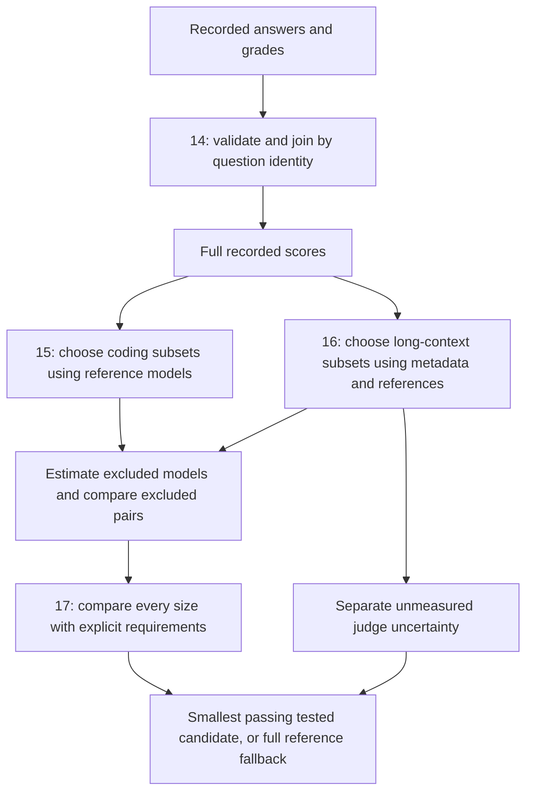

# Task 2, issues #14–#17: from recorded answers to a defensible decision

The goal is to shorten an AI evaluation while preserving the conclusions someone
would use to compare or accept models. A smaller test is valuable only if its
errors are acceptable for that particular decision.

These tickets implement the **offline experimental foundation of Part A**. Later
work integrates the method into evalscope; the multimodal Part B is separate.
Under issue #17's illustrative conservative policy, both benchmarks retain their
**full recorded reference**: 315 coding tasks and 100 AA-LCR tasks. This is a
measured fallback, not a claim that compression is impossible.

## The four questions, in order

| Ticket                                                                 | Plain-language question                                    | Deliverable                                                      |
| ---------------------------------------------------------------------- | ---------------------------------------------------------- | ---------------------------------------------------------------- |
| [#14](https://github.com/sdv1708/ai-model-quality-challenge/issues/14) | What are the trustworthy full scores?                      | Validated, joined, traceable grades and full means               |
| [#15](https://github.com/sdv1708/ai-model-quality-challenge/issues/15) | Which coding questions represent the whole exam?           | Structured selectors, weighted replay and uncertainty            |
| [#16](https://github.com/sdv1708/ai-model-quality-challenge/issues/16) | How do long documents and an AI grader change the problem? | Metadata-aware selectors and judge sensitivity                   |
| [#17](https://github.com/sdv1708/ai-model-quality-challenge/issues/17) | Which smaller test meets stated requirements?              | Shared gates, per-fold curves and an operating point or fallback |



## #14: build the answer key before shortening the exam

A **prediction** is the model's recorded answer. A **review** contains its grade.
JSONL means one JSON object per line. Files can be shuffled differently:
prediction line 1 and review line 1 need not describe the same question.

For example, predictions might arrive in order `[7, 2, 9]`, and reviews in order
`[9, 7, 2]`. Match index 7 to index 7 within its benchmark/model/subset identity.
Joining by position would attach grades to the wrong answers. Reject duplicate
indices, missing records, conflicting metadata and invalid grades before calculating.
Source paths and line numbers let every result be traced to its original records.

LiveCodeBench's stored `pass` is binary: the recorded code evaluation passed or
failed its tests. AA-LCR's stored `acc` is also binary, but an LLM judge produced
the verdict. The tested model and the judging model have different roles.
This program reads existing grades; it does not execute code or rejudge answers.

Full scores are means. Passing 241 of 315 coding tasks gives
`241 / 315 = 76.51%`. This is a successful fraction of recorded generations,
not automatically pass@k or a guarantee of code correctness on every input.

| Model        | Coding successes / 315 | Coding score | AA-LCR successes / 100 |
| ------------ | ---------------------: | -----------: | ---------------------: |
| gpt-oss-120b |                    241 |       76.51% |                    48% |
| kimi-k2.5    |                    198 |       62.86% |                    66% |
| minimax-m2.5 |                    195 |       61.90% |                    64% |

Part A has 415 tasks evaluated for three models: 1,245 grades. Separate MMMU
reference data adds 660 records. Issue #14 validates all 56 files and 1,905
normalized records; the supplied MMMU reference is not its full future benchmark.

## #15: choose representative coding questions

**Pruning** means retaining fewer questions. A 50% keep ratio retains
`ceil(315 * 0.5) = 158` coding tasks, or 50.16% after rounding.

Two methods use historical models' grades:

- `difficulty_stratified`: group tasks by how many reference models passed.
  With two references there are zero-pass, one-pass and two-pass groups.
- `response_stratified`: retain the complete reference pass/fail pattern.
  `[1, 0]` and `[0, 1]` remain separate groups, preserving distinctions that a
  simple count of one pass loses.

A **stratum** is a group. **Stratified sampling** takes representatives from
every occupied group. Each group gets a slot, then remaining slots follow its
population proportion. Reproducible SHA-256 priorities choose members within
groups. A seed selects a reproducible shuffle; it does not produce new answers.

Uniform random, easiest-only and hardest-only are comparison baselines. They
help expose trade-offs and bias, but are forbidden as final methods. Structured
sampling can still use random-like choices within groups.

### Why weighting changes the answer

Imagine 20 short tasks and 80 long tasks. Keep five from each. The subset is
half short, although the population is one-fifth short. If selected short tasks
score 80% and selected long tasks score 40%:

- Raw subset mean: `0.5 * 80% + 0.5 * 40% = 60%`.
- Population-weighted estimate: `0.2 * 80% + 0.8 * 40% = 48%`.

Each selected task in group h has weight `N_h / (N * n_h)`: group population
`N_h`, selected group size `n_h`, total population `N`. Weighting restores group
proportions. It cannot guarantee that the chosen representatives capture every
variation within their group.

### Why hold out a model?

Choosing questions using the tested model's grades would give an unfair advantage.
**Leave-one-model-out** fits using two references, then checks the third. Rotate
the excluded model. Changing its grades must not change its selected subset.
Its full score is revealed afterward to measure estimation error.

For rankings, **leave-two-models-out** excludes both compared models before
selection, leaving one reference. Compare the pair on the same questions and
weights. Three-model ordering within a one-model holdout includes two fitted
references: this is a separate, reference-assisted diagnostic. Never combine
estimates from unrelated subsets into a supposed common-test ranking.

## #16: long-context structure and uncertain grading

AA-LCR has 100 questions with benchmark inputs around 72,000–115,000 tokens.
A token is a unit of text processed by a model. Shared benchmark length is
distinct from model-specific usage accounting.

- `metadata_stratified` crosses input-length groups with document-count groups,
  protecting against retaining mostly short or single-document inputs.
- `length_difficulty_stratified` crosses length with reference-model pass counts,
  preserving historically different difficulty levels at different lengths.

Equal feature values stay together in empirical thirds. Selection covers every
occupied group; it does not hand-pick favorable questions. Metadata is available
before a new model runs. Historical difficulty assumes some transfer between
model families; exclusion tests probe that assumption with limited evidence.
Neither method establishes complete topic or reasoning-skill coverage.

**Judge noise** means repeated grading of the same fixed answer could change its
verdict. These data have one judgment per answer: actual repeat-judge variance
and flip rate are **unknown, not zero**. Comparing grades on different models'
different answers does not measure judge noise.

Sensitivity analysis asks a conditional question: what if grades changed?
On the full 100-question pool, one changed grade moves a score by one percentage
point. Kimi's 66% versus Minimax's 64% can tie after two directed grade changes
across the pair, or reverse after three. These are tipping counts, not estimated
probabilities. One heavily weighted selected grade can move an estimate by more
than one point.

## #17: turn measurements into an operating point

An **operating point** specifies a method, retained size and intended use. This
implementation compares both benchmarks using identical metric definitions and
gates, separately for every held-out model, pair and threshold. A pooled average
cannot conceal a failed fold.

The example policy was fixed in code before this ticket's new runs, after earlier
results were known. It is **retrospective and illustrative**, not independently
preregistered or an agreed customer requirement. Actual tolerances must be agreed
before independent validation. The command requires explicit thresholds.

| Gate                                       | Example requirement                                 |
| ------------------------------------------ | --------------------------------------------------- |
| Mean absolute score error (MAE)            | At most 3 percentage points in every held-out model |
| Worst individual score error               | At most 8 points across all folds/seeds             |
| Seed score standard deviation              | At most 3 points in every model fold                |
| Mean score-interval width                  | At most 20 points in every model fold               |
| Empirical score and pair interval coverage | At least 95% in every model/pair fold               |
| Pair point ordering agreement              | At least 95% for every independently excluded pair  |
| Pair interval decisiveness                 | At least 80% for every pair                         |
| Wrong decisive pair comparisons            | Zero observed                                       |
| Point threshold-decision agreement         | At least 95% in every model/threshold fold          |
| Threshold interval decisiveness            | At least 80% in every model/threshold fold          |
| False GO or NO GO decisions                | Zero observed                                       |

Machine reports use 0..1 units: 0.03 is 3 percentage points. Decisiveness and
false-decision fractions use **all runs** as denominator. Missing intervals fail
their gates. Baselines cannot be selected. Among passing candidates choose the
smallest count, then smallest worst-fold MAE, lexical strategy name and ratio.
At census every selector recovers the same pool; the winning name is a
bookkeeping tie, not evidence of method superiority.

### A score, a ranking and a decision answer different questions

Suppose a full score is 66%, the subset estimates 63%, and the customer requires
65%. The error is only three points, yet forcing a decision rejects a qualifying
model. If an interval is `[55%, 73%]`, it spans 65%: return **inconclusive** and
collect more evidence.

If the entire interval is at or above the threshold, return GO. If its upper end
is below the threshold, return NO GO. Otherwise abstain. A method abstaining 100%
of the time can make zero false decisions while providing no decision value.
This is why false decisions and decisiveness have separate gates.

Ranking is harder with close scores. The coding runner-up gap is
`3 / 315 = 0.95` percentage points; AA-LCR's is two points. Roughly accurate
scores need not preserve those orderings. Ties count explicitly.

### Measured fidelity curves

Pooled held-out MAE, in percentage points, across three folds and twenty fixed
seeds (descriptive repeated selections, not independent future-model trials):

| Retained | Coding difficulty | Coding response | AA-LCR length + difficulty | AA-LCR metadata |
| -------- | ----------------: | --------------: | -------------------------: | --------------: |
| 10%      |              4.94 |            5.38 |                      10.72 |           11.91 |
| 20%      |              3.38 |            3.41 |                       7.50 |            7.47 |
| 30%      |              2.50 |            2.64 |                       5.16 |            4.94 |
| 50%      |              1.53 |            1.61 |                       2.90 |            3.27 |
| 100%     |                 0 |               0 |                          0 |               0 |

At half retention, coding difficulty's worst-fold MAE is **1.83 points**, and its
worst mean interval width is **18.08 points**. Those score gates pass. But its
hardest independently excluded pair preserves point ordering only **60%** of
the time, with **0%** interval decisiveness for that pair. At the illustrative
70% coding threshold, at least one model fold is **0%** decisive.

AA-LCR length + difficulty has **2.90-point pooled MAE**, but **3.16-point
worst-fold MAE**: it fails the per-model three-point gate. Its hardest pair has
65% point agreement and 0% interval decisiveness. At the illustrative 60%
threshold the least decisive model fold is also 0%. Metadata's worst-fold MAE
is 3.72 points and its hardest pair agrees 70% of the time.

**No candidate below census passes this policy on the tested grid.** Retain
**315/315 coding and 100/100 AA-LCR**, with no claimed compression savings.
Ratios between 50% and 100% were not tested by this default run: this is not a
universal minimum. A custom grid is supported, but searching more ratios still
requires fresh validation. A weaker, separately declared rough-screening policy
could reach a different answer; changing gates after seeing results cannot
retroactively certify it.

### Confidence and stability, unpacked

Intervals ask what the fixed pool could contain given binary grades sampled
without replacement. The code inverts hypergeometric tails and combines stratum
bounds conservatively using Bonferroni allocations. Paired bounds use directional
disagreements on common tasks, without assuming independent model outcomes.

Nominal 95% coverage describes repeated sampling under the design assumptions,
not the probability that the chosen subset generalizes to another model.
Empirical 100% coverage over twenty seeds is not proof: wide intervals can cover
everything and decide little. Inspect width, decisiveness and errors together.
Deterministic hash priorities approximate uniform-within-group probability sampling.

Seed standard deviation measures estimate variation across subsets in one model
fold. **Jaccard similarity** measures intersection divided by union. For
`{1,2,3}` and `{2,3,4}` it is `2 / 4 = 0.5`. Low overlap can be healthy when
interchangeable representatives give stable estimates. High overlap alone does
not establish accuracy. Fold Jaccards remain reported; score dispersion is gated.

## Reproduce and inspect

From `task2/`, with Python 3.12:

```powershell
uv sync --locked
uv run part-a-operating-points --data-root ../Evals --output-dir output/operating-points --lcb-thresholds 0.7 --aa-lcr-thresholds 0.6
uv run python tools/audit_lcb.py --data-root ../Evals --reports output/operating-points/live_code_bench_v5
uv run python tools/audit_aa_lcr.py --data-root ../Evals --reports output/operating-points/aa_lcr
uv run python tools/audit_operating_points.py --reports output/operating-points
```

Thresholds above are examples. Several explicit thresholds are supported, e.g.
`--lcb-thresholds 0.65 0.7 0.75`; every model/threshold fold must pass.
`--keep-ratios` changes the retained-fraction grid; `--seeds` needs at least two
unique integers. Omitting census can yield `selected: null`: no tested point
satisfies the policy.

`operating_points.json` retains the policy, gates, failures, full fold summaries
and limitations. `curves.csv` is its compact table. Benchmark subdirectories
retain all #15/#16 traces, including selection weights, reference identities,
grades, intervals and judge sensitivity. The root manifest hashes reports,
child manifests and package source. Verify hashes before trusting copied results.
Both analyses validate before publication. Replacement is atomic per file, not
a whole-directory transaction: use one writer and fixed inputs.

Compact curves and selected points are checked in under `../docs/data/`.
`operating_points.py` owns policy comparison; `operating_cli.py` owns the replay.

## What external calls would add

Offline replay is possible because complete historical grades already exist.
It is like investigating a shorter exam using fully marked past papers. Excluded
grades stay out of fitting and are revealed afterward to check estimates.

Fresh calls test claims beyond this table: evaluate an untouched model on the
full pool after freezing requirements; repeat generation to measure answer
variation; regrade identical fixed answers to measure judge variation; obtain
human adjudication for systematic grading bias; and measure latency and billing
to establish real savings. More seeds cannot replace more model families or
repeated judgments.

Searching methods and sizes on these folds makes them development evidence.
A fourth model used for tuning becomes development evidence too. Reserve
untouched evidence for final evaluation. New question pools and whole AA-LCR
document-set holdouts test another generalization axis.

## Practice defending it

1. Why must predictions and reviews join by identity before any statistics?
2. Calculate the 48% weighted example and explain the raw 60% estimate's imbalance.
3. Which grades may selection see in a score fold versus a pair fold?
4. Why does 2.90-point pooled error fail a three-point per-model policy?
5. Why can approximate scores be useful while a close ranking remains unreliable?
6. Why are zero errors with zero decisiveness insufficient?
7. Why keep the full reference rather than weaken gates after inspecting curves?
8. Why does full retention leave judge uncertainty unresolved?
9. What do the tested-grid and fresh-model qualifications mean?
10. How does this feed later evalscope integration (#18–#21), and how does the
    separate MMMU probe (#22–#23) differ?

Start with the [eight-question exercise](learning/benchmark-walkthrough.html),
then read [#14](INTERVIEW_GUIDE.md), [#15](ISSUE_15_GUIDE.md), and
[#16](ISSUE_16_GUIDE.md) for implementation details.

## Primary statistical references

- [NIST: confidence-interval interpretation](https://itl.nist.gov/div898/handbook/prc/section1/prc14.htm)
  explains repeated-sampling coverage. Our finite-pool construction differs
  from that page's illustrative normal-mean formula.
- [NIST statistical glossary](https://www.itl.nist.gov/div898/handbook/glossary.htm)
  describes the hypergeometric model for sampling without replacement.
- [scikit-learn: nested versus non-nested validation](https://scikit-learn.org/stable/auto_examples/model_selection/plot_nested_cross_validation_iris.html)
  explains optimism when method selection and assessment reuse evidence. This
  motivates fresh-model validation; our three-model protocol is not nested CV.
