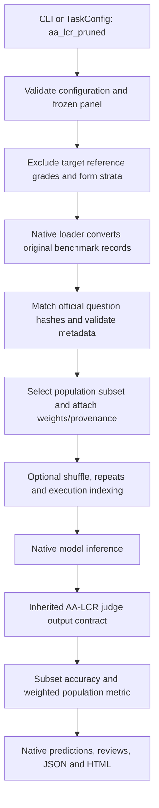

# Understanding issue #20: AA-LCR inside EvalScope

Issue #16 researched the selectors. Issue #17 chose the defensible operating
point. Issue #18 established the native extension. Issue #19 integrated coding
selection. **Issue #20 makes AA-LCR selection available through the real framework.**
The implementation lives in private `sdv1708/evalscope-pruning`; this submission
repository contains the frozen reference panel, provenance lock and independent
audit. The user explicitly requested implementation of this learner-labelled
ticket; this guide supports understanding without claiming personal mastery.

## 1. What AA-LCR measures

AA-LCR means Artificial Analysis Long Context **Reasoning**. The historical
benchmark has 100 questions requiring reasoning across long document collections.
Typical inputs are around 100,000 tokens: financial reports, papers, government
consultations and other real documents. It asks whether a model can connect facts
and reason over them. Possessing a large context window does not guarantee this.

The model produces an answer. A separate judge model compares that answer with
the official reference and returns CORRECT/INCORRECT. The native binary `acc`
grade is 1 or 0. Ordinary full accuracy is the average of those grades.
The reference results are GPT-OSS 48/100, Kimi 66/100, MiniMax 64/100.

Primary sources researched before implementation:

- [Official release and task rationale](https://artificialanalysis.ai/articles/announcing-aa-lcr)
- [Dataset card, fields, revisions and grading](https://huggingface.co/datasets/ArtificialAnalysis/AA-LCR)
- [EvalScope AA-LCR behavior](https://evalscope.readthedocs.io/en/latest/benchmarks/aa_lcr.html)
- [Framework contribution conventions](https://evalscope.readthedocs.io/en/latest/advanced_guides/add_benchmark.html)
- Pinned EvalScope implementation, loader, judge contract and existing native pruner

The benchmark card now documents v1.1 with changed answers/judge instructions.
It explicitly warns against direct comparison with v1.0. We pin v1.0 revision
`bdae010bbce259820c0e34c1d7cce210d966fb75`. A current leaderboard is not a baseline
for our historical grades. The pinned framework judge is also distinct from newer
official grading: framework compatibility is not a claim of current leaderboard parity.

## 2. What was selected, and why the default is 100%

The selected strategy is `length_difficulty_stratified`; the defended retained
fraction is **1.0**. No smaller candidate tested in #17 passed every conservative
fidelity gate. Implementing a pruner does not justify advertising compression.
Lower ratios remain available for research and reproduce the analysis selections.

`prune_ratio=0.3` means **retain 30%**, not remove 30%. For N=100 it keeps 30.
For fractional counts, `ceil(N*ratio)` rounds up. Valid ratios are finite numeric
values in (0,1]. Booleans, strings, NaN, infinity and out-of-range values fail.

This full-reference fallback is a valid scientific conclusion. Integration and
evidence preservation are complete even when a smaller production subset is not
defensible. A future model panel may support stronger compression after validation.

## 3. The two strategies

Both start with fixed benchmark `input_tokens`. These are the original benchmark
length estimates, not provider usage or newly measured inference tokens. Sort the
values and form empirical thirds using midranks so equal values stay together.

`length_difficulty_stratified` crosses those length bands with the number of
remaining historical reference models that passed the question. Length captures
context/cost variation; pass counts are a historical difficulty proxy. Transfer
to a new model is a hypothesis tested on held-out models, not an assumed guarantee.

`metadata_stratified` crosses length bands with empirical thirds of the number
of distinct canonical source URLs. It does not require reference grade values
for its features. URL count is a document-set complexity proxy, not a semantic
diversity measure or a requirement to cover every domain/document set.

The panel supplies original analysis indices, official question hashes, token
counts, canonical URL sets and reference grades. It contains no target answers or
model generations. LiveCodeBench and AA-LCR share allocation/reporting mechanics;
AA-LCR retains its own features and native judge semantics.

## 4. How allocation and determinism work

Each occupied length/second-feature group is a **stratum**. Give every occupied
stratum one slot, then allocate remaining slots to the largest proportional
deficit. Break ties by lexical group name. Reject budgets too small to cover all
strata; never give an unobserved stratum an invented score.

Inside a stratum, rank candidates by SHA-256 of `lcb-pruning-v1:{seed}:{index}`.
The name is historical: #16 deliberately reused #15's allocation and priority
design. Changing it to a prettier AA-LCR namespace would change validated IDs.
The smallest priorities win. Sort selected tasks by original index afterward.

This produces the same selection for the same population, ratio, strategy, seed
and reference exclusions, independent of source/panel row order or global random
state. Changing the seed may change the members. Determinism is reproducibility,
not proof that an estimate is accurate.

## 5. Why population weights are necessary

Suppose 12 questions form strata of sizes 2, 2 and 8. We retain one per stratum.
The selected questions represent different amounts of the full benchmark.
Their weights are **1/6, 1/6 and 2/3**.

In general, a retained question in stratum h receives `N_h/(N*n_h)`:

- `N_h`: original size of this stratum
- `N`: original population size
- `n_h`: retained size of this stratum

If only the large stratum's retained question passes, the ordinary subset mean
is 1/3 while the population estimate is 2/3. The latter corrects the allocation;
it still has sampling uncertainty when fewer than all questions are retained.

EvalScope retains ordinary subset accuracy and adds the separate metric identity
`accuracy / weighted_mean / scope=population`. Its score is
`sum(weight_i * mean_attempt_grade_i)`. `num` counts unique selected questions.
Repeated generations are averaged within each question before its weight applies.
They do not multiply that question's population contribution.

## 6. Preventing leakage

When evaluating Kimi, Kimi's historical grades must not determine its own
difficulty groups. The adapter excludes target string names, underlying model
names and custom display IDs before forming strata. Additional exclusions support
pair holdouts. At least one reference must remain. For renamed provider aliases,
explicitly list the matching historical model in `excluded_reference_models`.

Otherwise we could choose an apparently representative subset using information
from the very model being evaluated. That would exaggerate future-model evidence.
An unseen model needs no grades: the frozen historical panel supplies features.

## 7. What the framework integration actually does

The registered name is `aa_lcr_pruned`. It inherits the existing `AALCRAdapter` and
the shared reference-pruning adapter. It is not a standalone evaluation script.



Selection happens before expensive model inference. The population loader still
reads the corpus to validate eligible source identities, so selection does not
eliminate corpus-download or prompt-construction overhead. `limit` is rejected:
truncating after selection would break the sampling design.

Original analysis indices remain in `sample.metadata.pruning.index`. Framework
execution IDs are reindexed, including repeat groups. Confusing these IDs would
silently join grades to the wrong questions. Saved reviews preserve both identity
and selection provenance, including panel hash, seed and reference names.

## 8. Two source findings that affect reproducibility

All 100 questions match the pinned official source. Ninety-five recorded question
strings match exactly. Five match an exact encoding transformation: UTF-8 decoded
as Mac Roman. The exporter explicitly verifies that transformation and records
indices 4, 20, 61, 64 and 80. It does not guess using row position or fuzzy matching.
Runtime hashes bind to official text and reject unknown question identities.

The native source adapter previously iterated document directories. The new path
reads the declared `data_source_filenames` order, following the official data
contract, and rejects missing/empty documents. It avoids filesystem-order drift.
Correcting text/order means fresh live scores are not exact reproduction of old
prompts. Our parity claim is about selection and fixed-grade replay only.

Remote runs require `dataset_hub='huggingface'` to use the pinned revision. A
local mirror is supported through native `local_path`, with extracted `text_dir`.
The source must still contain every panel question and agree in token counts and
URL sets. A different source cannot silently redefine the population.

## 9. Judge noise versus sampling uncertainty

There are two different uncertainties:

- **Sampling uncertainty:** which questions were retained from the fixed population.
- **Judge uncertainty:** whether the judge labels the same fixed answer differently,
  or labels it incorrectly relative to human ground truth.

There is one stored grade per answer, so repeat-judge variance/flip rates are
**unmeasured**. Repeating model generation does not estimate repeat-judge variance.
Temperature zero does not establish error-free judging. The full reference
removes question-sampling error, while judge uncertainty remains.

The native contract accepts structured CORRECT/INCORRECT verdicts. Malformed
responses and transport failures are excluded, never silently scored zero.
Because a lost question could bias the weighted estimate, the population metric
fails closed unless every planned question/attempt has a usable binary grade.
Its metadata explicitly warns that judge noise is unmeasured.

Kimi 66/100 versus MiniMax 64/100 is a two-percentage-point gap. Two adverse grade
cell changes can tie it; three can reverse it. This is an adversarial sensitivity
bound, not an estimated chance of judge error. Rejudge fixed answers repeatedly
under a controlled judge protocol before claiming measured judge robustness.

## 10. How to interpret the earlier fidelity metrics

MAE is average absolute score error; worst error guards against one bad fold.
Ranking agreement asks whether ordering is preserved, while pairwise holdouts
exclude both compared models from reference features. A threshold decision asks
whether an illustrative pass bar is reached; a decisive interval stays entirely
on one side of the bar or of a pairwise zero-difference boundary.

Interval coverage asks whether fixed full-reference truth lies inside the
sampling interval; interval width measures precision. These intervals condition
on stored grades and exclude judge randomness. Seed standard deviation and
Jaccard overlap describe selection sensitivity; they are not new independent
models. Token fraction is an input-cost proxy, not a provider bill or latency
measurement. Three historical models do not guarantee transfer to a fourth.

## 11. What verification establishes

The native loader/replay audit checks 1,200 cases: two candidates x five ratios x
twenty seeds x six exclusions (three single-model and three pair holdouts).
It compares against the independent analysis implementation: IDs, strata,
population/selected counts, weights, reference names and weighted replay scores.
Full retention recovers 48%, 66%, 64% from historical grades.

Those fixtures contain real pinned question metadata and tiny synthetic contexts.
They are never inferred or judged. A separate real CLI smoke uses synthetic
candidate and judge endpoints on loopback and checks predictions/reviews/reports.
Neither result certifies external provider behavior or new-model accuracy.

Framework tests additionally check invalid configuration, source drift, target
exclusion, repeats, weighted scoring, valid/invalid judge outputs and registration.
Full relevant framework and challenge checks are recorded in `docs/issue-20-evidence.md`.

## 12. Run it and explain it back

The private repo's `AA_LCR_PRUNED.md` contains installation and live configuration.
The quickest credential-free run there is:

```powershell
python examples/aa_lcr_pruned/smoke.py
```

Inspect one review's `sample_score.sample_metadata.pruning`, then find the
`weighted_mean` metric in the JSON report. Explain why its `num` is three and
why that synthetic score of 1.0 says nothing about a real model.

From this repository's `task2/`, regenerate the frozen panel using the pinned CSV:

```powershell
python tools/export_aa_lcr_panel.py --data-root ../Evals --source-csv output/aa-lcr-source/AA-LCR_Dataset.csv --output data/aa-lcr-reference-panel.json
```

Use the native EvalScope Python with this `task2/src` on `PYTHONPATH` to run
`tools/audit_evalscope_aa_lcr.py --data-root ../Evals --panel
data/aa-lcr-reference-panel.json --source-csv output/aa-lcr-source/AA-LCR_Dataset.csv
--output output/aa-lcr-native-audit.json`. Resolve paths from the command's cwd.
The pinned CSV download URL is recorded in `evalscope-aa-lcr.json`.

Try these interview questions without reading the answers above:

1. Why does a pruner ship with a retained fraction of 1.0?
2. Derive the 1/6, 1/6, 2/3 weights and explain the 1/3 versus 2/3 estimates.
3. What leaks if the evaluated model participates in difficulty estimation?
4. Which operations happen before inference, and why must limit be rejected?
5. Why doesn't a zero sampling interval at full retention imply a perfect score?
6. What exactly did 1,200 passing audit cases prove, and what remains unmeasured?
7. Why pin both framework and dataset versions? Why record the judge configuration?
8. Why is fixed-grade replay different from a fresh run after correcting text/order?

The saved-run comparison command belongs to #21. This ticket supplies its native
datasets, metric identities and provenance; it does not implement that next ticket.
