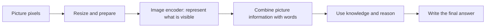

# Issue #22: from picture puzzles to an interview-ready probe design

Read [the technical design](MMMU_PROBE_DESIGN.md) for the complete contract and
citations. This guide teaches why each decision exists. Everything called a
worked example below is invented to explain the arithmetic, not a model result.
Your explicit implementation request authorized assistant authorship of this
learner-labelled design ticket; practise the explanations and challenge the
choices rather than presenting unrun experiments as your own measurements.

## 1. Start with a child-sized story

Imagine a robot looking at a picture of two baskets. A label says one basket has
three apples and the other has five. You ask which basket has more apples.

The robot needs to do several jobs: see the labels, remember what the numbers
mean, compare them, and say the right basket. If it answers incorrectly, we do
not yet know which job went wrong. Giving it thousands of picture puzzles and
counting right answers tells us how often the whole chain succeeds. It does not
tell us whether its eyes are the problem.

Issue #22 designs a small, organized set of picture puzzles and special checks
that help locate the problem. We call that set a **probe**. It is an experiment
plan, not a trained model and not a new image encoder.

## 2. Translate the important words

| Word           | Everyday meaning                                  | Technical meaning here                                          |
| -------------- | ------------------------------------------------- | --------------------------------------------------------------- |
| Benchmark      | A shared exam book                                | A fixed collection of tasks and scoring rules                   |
| MMMU           | Picture puzzles from many school subjects         | A multimodal knowledge/reasoning benchmark                      |
| Multimodal     | Uses words and pictures together                  | Receives multiple input modalities                              |
| Image encoder  | Part of the robot's visual machinery              | Converts pixels into representations used downstream            |
| Visual path    | Everything between picture and usable information | Preprocessing, encoder, projection/fusion and their interaction |
| Stratum        | A labelled basket of questions                    | A mutually exclusive sampling group                             |
| Oracle control | A carefully checked description                   | Independent factual text replacing visual extraction            |
| Perturbation   | A controlled picture change                       | A versioned intervention such as resampling                     |
| Estimand       | The exact question our number answers             | For example, average accuracy on the frozen test frame          |
| Confound       | Another thing changed at the same time            | A competing explanation for the observed effect                 |
| Inconclusive   | We need more evidence                             | The evidence cannot safely settle a required decision           |

The encoder is only one part of the visual path. An API usually hides those
parts. Say “evidence of a visual-path problem” unless the experiment actually
isolates the encoder. That careful wording is a strength in an interview.



An error at any step can produce the same wrong final answer. The controls help
us investigate which explanation fits the evidence.

## 3. Why 660 is not the whole book

The official metadata totals 11,550 questions: 150 development, 900 validation
and 10,500 test. The task brief rounds this to approximately 12,000. The supplied
folder has only 660 questions for one historical model across 22 subjects, all
with validation source IDs. Eight subjects are absent, including Music and Math.

Imagine checking a school using only science and art worksheets, then claiming
you tested music too. A large number of worksheets cannot repair a missing
subject. We inventory all 30 subjects before choosing the small probe.

Development and validation are our practice worksheets. Test is the book we
save for the final check. The proposed final score describes test, not a mixture
of practice and test. Reusing practice questions as final evidence can make a
method look better because we already tuned it to those examples.

Research also found that official test answers are now released. Old adapter
text still says they are withheld. The right response is to pin the actual
source and join the released answers by question ID, not repeat stale guidance.
Answers stay in the scoring room and never go into the model's prompt.

## 4. Why two little exam books are better than one confused number

**Panel R represents the population.** Initially it has 360 questions, twelve
per subject. Within each subject we retain difficulty diversity and randomly
choose within declared groups. We save the seed and exact IDs. This helps us
estimate how the model would do on the much larger fixed test pool.

**Panel S searches for diagnostic coverage.** Initially it adds 120 questions
chosen to fill missing visual categories: tiny labels, charts, maps, medical
images, music notation and more. It is allowed to contain unusually stressful
images because its purpose is to uncover failure modes.

Suppose a car factory tests ordinary cars to estimate defect rates and also
crash-tests cars under stressful conditions. Both tests matter, but averaging
their results together would answer a strange question. Likewise, S's deliberately
unusual examples do not receive invented population weights.

The 480-question total is a starting budget, not a proven smallest sufficient
test. We have not selected it or checked its quota feasibility against all
images. If the required coverage cannot fit, the design says to expand or
declare the budget insufficient. It never silently pretends missing coverage
was achieved.

## 5. Why a plain average can mislead

Worked example: the full book contains 80 chart questions and 20 medical
questions. Our small sample contains ten of each. The robot gets eight chart
questions and four medical questions right.

A plain average says `12/20 = 60%`. But half our sample was medical, although
medical questions are only one-fifth of the full book. To estimate the full
book, use its actual proportions:

```text
chart success = 8/10 = 80%
medical success = 4/10 = 40%
population estimate = 0.8 × 80% + 0.2 × 40% = 72%
```

That is **weighting**. In the actual proposal the sampling groups are subject
and difficulty; chart/medical labels are additional diagnostic margins. A group
with `N_h` full questions and `n_h` sampled questions gives each sampled question
weight `N_h/(N*n_h)`. Weights correct unequal sampling, not bad annotations,
missing groups, cheating or a changed customer workload.

## 6. The six checks, using one chart puzzle

Imagine a chart whose blue line reaches 8 and red line reaches 3. The question
asks which line has the larger value.

1. **O, original:** show the chart and ask the question.
2. **N, no image:** keep the same question/options, but remove the picture. This
   checks whether the text gives away the answer or guessing/prior knowledge helps.
3. **E, equivalent text:** replace the chart with a checked factual description,
   “blue reaches 8; red reaches 3.” Do not say “choose blue.” The model still has
   to perform the comparison.
4. **P1, mild stress:** show a slightly reduced-resolution chart whose facts are
   still readable to independent reviewers.
5. **P2, stronger stress:** show the stronger checked version of the same change.
6. **V, visual facts:** ask for the blue and red values directly and compare
   those extracted facts with an independent rubric.

Each condition gets two attempts in a fresh conversation. We do not show the
model its earlier answer. We save both attempts rather than choose its best one.

If original fails, equivalent text succeeds, no-image fails and visual extraction
fails, the visual path becomes a plausible suspect. It is still not proof of
a specific encoder bug: different prompt modalities can affect reasoning too.
If both original and equivalent text fail, we need more investigation; reasoning,
knowledge, an incomplete description or several problems may be involved.

## 7. Why the controls must be independent

An oracle is not magical. If the tested model writes its own chart description,
it may repeat the exact reading mistake we are investigating. If we write a
description after seeing the model fail, we might accidentally give it a hint.

The plan therefore uses independent annotators, fixed rubrics and descriptions
written without candidate outputs or the final answer. A second person checks
them. Pictures in answer options also need descriptions, with equal detail and
unchanged option order. Some pictures cannot be faithfully translated to text;
we mark that control unavailable and show the gap.

This is similar to checking a child's eyesight: someone else must know what is
on the eye chart. The child's own guess cannot become the correct label.

## 8. What stresses vision, and what makes a test unfair

Small text checks reading detail. Charts check axes and legends. Diagrams check
arrows and connectivity. Spatial tests check positions and small objects. Clutter
tests check distraction. Color tests check distinctions. Specialized imagery
checks symbols and features that ordinary photos may not expose.

But deleting the only useful information creates an impossible question. If red
and blue are the only way to identify two lines, turning both into identical
gray is not a fair test with the old answer. It can be a destructive negative
control, but it cannot count as a label-preserving robustness failure.

Likewise, if shrinking an arrow makes it disappear for humans, a wrong answer
does not establish encoder degradation. We save exact image changes and require
human checks that the necessary facts remain available. Proposed severity values
must first be calibrated on practice data.

## 9. Understand the API without memorizing jargon

The API is a service counter: we send an envelope containing the question and
the images, and receive an envelope containing an answer. OpenAI-compatible
means the provider accepts a familiar envelope shape. It does not mean every
provider resizes images the same way or supports the same settings.

The design uses Chat Completions, ordered text/image content and a pinned model.
It checks capabilities before evaluation. Images embedded in options must stay
at the right positions. The program records the request, image hashes, answer,
model settings, errors, duration and usage, while keeping credentials secret.

Think of the manifest as the experiment's receipt. Without it, a lower score
could be caused by a different image, model version, prompt or token limit.
Temperature zero reduces one source of randomness; it does not promise that
the serving system will always return the same answer.

## 10. Three failures that mean different things

- A completed answer saying the wrong letter is a capability failure.
- A completed reply without a valid final answer is a formatting failure under
  the frozen scoring contract.
- A timeout or rejected image gives no valid capability observation. It is a
  reliability failure and missing score evidence, not an automatically wrong
  answer or an excuse to drop the question silently.

For missing outcomes we report coverage and possible best/worst completions.
For transient transport errors we use limited retries, preserving their cost
and history. We never retry just because the answer was wrong.

The official MMMU multiple-choice parser can guess a random option when parsing
fails. This diagnostic design deliberately does not. It records format failure,
so its scores must not be advertised as official leaderboard-equivalent scores.

## 11. Read the metrics in plain language

Worked example on the same weighted panel:

```text
original O = 70%
no-image N = 45%
equivalent text E = 85%
stronger stress P2 = 60%
```

Image gain is `70 - 45 = 25 percentage points`: images helped overall. Oracle
gap is `85 - 70 = 15 points`: bypassing visual extraction improved this task.
Stress loss is `70 - 60 = 10 points`: the controlled change reduced success.
None of these numbers alone proves encoder causation.

“Percentage points” means direct subtraction of percentages. A move from 70%
to 60% is a ten-point loss, approximately a 14.3% relative reduction. Those are
different units, so name the one you use.

To compare a baseline and candidate, compare changes on the same questions.
If the baseline oracle gap is 10 points and the candidate gap is 15 points,
the visual-regression contrast is +5 points. Check whether equivalent-text
reasoning performance changed too; otherwise you may blame vision for a broader
model change. Direct visual facts and stress tests provide additional evidence.

## 12. Why a small test sometimes cannot decide

Imagine tasting one spoonful of soup to decide whether the whole pot is salty.
If it is well mixed, that helps. If ingredients collect in corners, a single
spoonful can mislead. Stratification is how we deliberately visit different
corners; uncertainty is how we acknowledge what we have not tasted.

We use per-question paired differences and the known sampling groups to estimate
sampling uncertainty. Repeating the same question does not make it a new question.
Two attempts mainly help reveal instability. Shared images and repeated facts
can create dependence, so the plan also requires a duplicate-group sensitivity
analysis. Annotation errors and API variability are additional uncertainty sources.

A GO requires enough evidence that every agreed minimum/maximum is satisfied.
If the plausible range straddles the requirement, the answer is inconclusive.
That is useful information: it tells us to collect more evidence before promising
a customer the model is ready. Customer thresholds must be agreed before looking
at final results. The proposal's example thresholds are illustrative only.

## 13. Count the real cost

The nominal probe uses 480 unique questions, but six conditions and two attempts
make `480 × 6 × 2 = 5,760` calls **per system**. Comparing two systems needs
11,520 main calls. Preflight, pilot, retries and annotation add cost.

The same rich protocol on all 10,500 test questions would take 126,000 calls per
system. An ordinary one-pass full test takes 10,500 calls and answers a narrower
question. Comparing 480 with 10,500 and claiming an identical reduction in cost
would confuse questions with requests and ignore different image/token costs.

No live calls were made for this issue. Therefore we have no measured encoder
accuracy, robustness curve, selected subset or dollar saving. What we do have is
a reproducible inventory and a precise proposal for obtaining that evidence.

## 14. Where this fits in the project

Issue #14 validated the supplied artifacts. Issues #15–#17 studied Part A subset
fidelity; #18 established the native framework baseline; #19–#20 implemented Part A
pruners; #21 added saved-run comparison. #22 supplies the forward-looking MMMU
experiment design requested in Part B.

The default native MMMU adapter runs validation. It does not automatically run
the full test frame or implement this six-condition probe. A future adapter must
live inside EvalScope, preserve source IDs/image order, join released labels and
save the new protocol metadata. No new runnable probe command exists in this
change. A written Part B design is explicitly permitted by the challenge spec.

## 15. Answers to practise aloud

**What did you deliver?** A researched full-dataset MMMU probe proposal, an
inventory audit and a learning guide. The experiment is specified but unrun.

**Why is MMMU accuracy not encoder accuracy?** Final answers combine perception,
subject knowledge, reasoning and formatting. Some questions are answerable
without images. I use paired controls and direct visual-fact checks.

**What is the strongest causal claim you can make?** Black-box patterns can
implicate the visual path. Isolating the encoder needs an intervention that
holds the rest of the system fixed. I would not infer it from one failure.

**Why not random sampling?** Whole-pool random sampling can miss rare visual
stressors. My population panel stratifies by subject/difficulty, while a separate
coverage panel targets image categories and failure mechanisms. Random selection
within declared strata supports estimation; it is not the complete strategy.

**Why not choose the hardest examples?** Difficulty may measure reasoning rather
than vision, and one historical model's failures can overfit selection. I select
from metadata and independently annotated visual properties before candidate
outcomes are observed.

**How do you avoid leakage?** Separate calibration and confirmation, audit
duplicates, freeze prompts/selection, keep labels out of requests, and do not
redraw after results. Released public answers still leave training contamination
unresolved, so independent fresh tasks would strengthen the conclusion.

**What if the oracle is wrong?** Independent creation and review reduce that
risk; explicit missing-control counts and sensitivity analysis keep the limits
visible. Oracle success is evidence, not ground truth about internal causation.

**What would justify a smaller probe?** Independent calibration showing required
coverage, stable conclusions and tolerable uncertainty at lower budgets, followed
by one frozen confirmation. This proposal has not established that 480 suffices.

**What does sales gain?** A concrete explanation of which visual workloads look
safe, which stressors need investigation, and when evidence is insufficient.
The customer gets conditional evidence rather than an unsupported encoder claim.

**What would you do next?** Census full images/metadata, verify answer joins,
annotate controls, test quota feasibility, pilot transformations and provider
cost, freeze the protocol, then evaluate independent systems.

## 16. Your one-minute answer

“I designed a compact MMMU experiment for visual capability. I started from all
30 subjects rather than the supplied 660-row reference. I separated a weighted
population panel from a diagnostic coverage panel. On each question I compare
original images, no image, independently checked equivalent text, two controlled
image stresses and direct visual-fact extraction. I preserve question identity,
image order, API settings and scoring provenance. I report paired effects,
uncertainty, missing evidence and actual cost. This can identify visual-path
concerns, but I cannot claim an internal encoder fault from a black-box API.
The result is a researched design; the next step is to pilot and validate it.”
